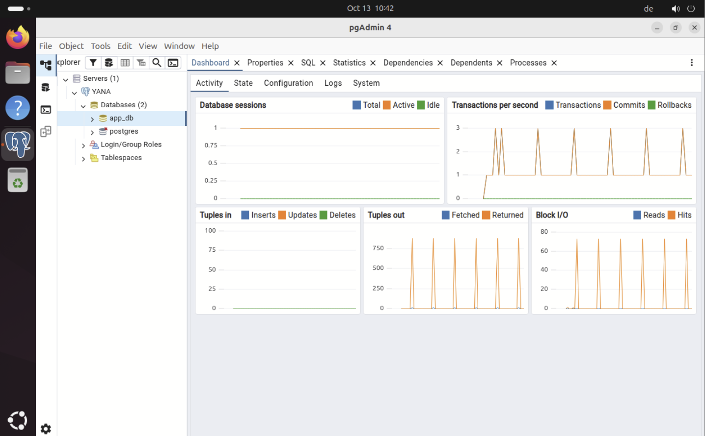

# PostgreSQL 16 und pgAdmin 4

## 1. PostgreSQL installieren

```bash
sudo apt update
sudo apt install postgresql postgresql-contrib -y
```

Auf Ubuntu 24.04 wurde PostgreSQL 16 eingesetzt. Anschließend den Zustand prüfen:

```bash
sudo systemctl status postgresql
pg_lsclusters
```

Der Sammeldienst `postgresql.service` kann `active (exited)` zeigen, obwohl die eigentliche Cluster-Instanz aktiv ist. Maßgeblich ist bei `pg_lsclusters` der Zustand **`online`**. Dieser wurde im Projekt bestätigt.

## 2. Eigene Datenbank und Rolle anlegen

```bash
sudo -u postgres psql
```

Beispiel-SQL im `psql`-Prompt (mit selbstgewähltem Geheimnis):

```sql
CREATE USER app_user WITH PASSWORD 'PASSWORT_NUR_LOKAL_EINSETZEN';
CREATE DATABASE app_db OWNER app_user;
\l
\q
```

> **Sicherheitsregel:** Das oben gezeigte Passwort ist **kein** echtes Passwort, sondern ein Platzhalter. Für die reale Einrichtung ein einzigartiges Passwort verwenden und **nur** im eigenen Secret-Speicher hinterlegen; niemals in GitHub veröffentlichen. Zum sicheren, interaktiven Ändern eines bereits angelegten Passworts kann `\password app_user` im `psql`-Prompt verwendet werden.

Verbindung lokal testen:

```bash
psql -h 127.0.0.1 -U app_user -d app_db
```

Erwartet: Passwortabfrage und Prompt `app_db=>`.

## 3. pgAdmin 4 Desktop installieren

Es wurde die **Desktop-Variante** gewählt, da GNOME bereits vorhanden ist und die Verwaltung über die IONOS-Konsole erfolgt.

```bash
sudo apt install curl gnupg -y
sudo mkdir -p /etc/apt/keyrings
curl -fsS https://www.pgadmin.org/static/packages_pgadmin_org.pub \
  | sudo gpg --dearmor -o /etc/apt/keyrings/packages-pgadmin-org.gpg
sudo sh -c 'echo "deb [signed-by=/etc/apt/keyrings/packages-pgadmin-org.gpg] https://ftp.postgresql.org/pub/pgadmin/pgadmin4/apt/$(lsb_release -cs) pgadmin4 main" > /etc/apt/sources.list.d/pgadmin4.list'
sudo apt update
sudo apt install pgadmin4-desktop -y
```

Offizielle Anleitung: <https://www.pgadmin.org/download/pgadmin-4-apt/>.

## 4. PostgreSQL in pgAdmin registrieren

1. pgAdmin 4 über die GNOME-Anwendungsübersicht starten.
2. Unter **Servers → Register → Server** einen lokalen Servereintrag erstellen.
3. Im Tab **Connection** diese Werte setzen:

| Feld | Wert |
|---|---|
| Anzeigename | `YANA` (frei wählbar) |
| Host | `localhost` oder `127.0.0.1` |
| Port | `5432` |
| Maintenance database | `app_db` |
| Username | `app_user` |
| Password | **Nicht dokumentieren / lokal hinterlegen** |

Die Verbindung wurde erfolgreich getestet. Unter `Servers → YANA → Databases → app_db` lassen sich die Tabellen und das **Query Tool** öffnen.



*Abbildung: pgAdmin-Oberfläche nach erfolgreicher PostgreSQL-Anbindung.*

## 5. Datenbankschema einspielen

Die Tabellen wurden mit einem SQL-Skript im Query Tool erstellt: `app_db` auswählen → Rechtsklick → **Query Tool** → SQL einfügen → **F5**. Das vollständige Schema und die bereits eingefügten Testdaten befinden sich in [Datenmodell und SQL](../technik/datenmodell.md).

## Sicherheit

- Der Datenbankport **5432/TCP bleibt extern geschlossen**.
- FastAPI greift über `127.0.0.1` auf PostgreSQL zu.
- Die Datenbankzugangsdaten liegen lokal in einer geschützten `.env`-Datei, nicht im Quellcode.
- Datenbankrollen für Schreib-/Lesezugriff später differenzieren; derzeit ist `app_user` Eigentümer der Datenbank.
