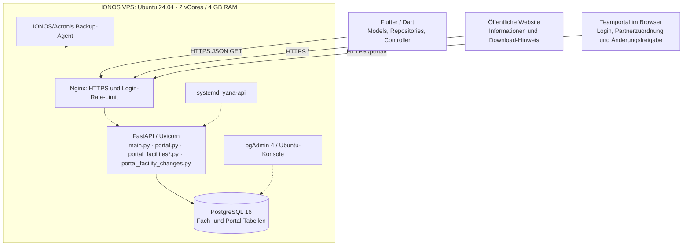
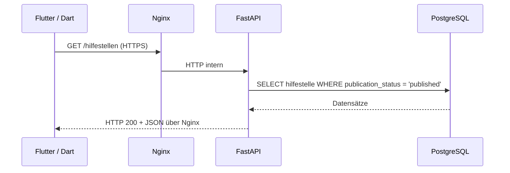

# Technische Systemarchitektur

**Stand: 24.11.2026**

## 1. Architekturprinzip

YANA verwendet eine **Client-Server-Architektur** mit gemeinsamem FastAPI-Backend und PostgreSQL-Datenbank. Es gibt drei wichtige Clients: die Flutter-App, die **öffentliche HTML-Website** und den **geschützten Browserzugang zum Teamportal**. Nginx terminiert HTTPS; der Backend-Dienst wird über `systemd` betrieben.



Die Website und das Portal werden nicht auf einem zweiten Webserver betrieben; sie verwenden denselben FastAPI-Prozess wie die REST-API. **Die Datenbank ist nicht öffentlich erreichbar.** Die getrennte Test-Codekopie greift derzeit auf dieselbe DB zu; diese Einschränkung wird unter [Portal-Tests](teamportal-tests.md) erläutert.

## 2. Verantwortlichkeiten

| Komponente | Aufgabe | Bestätigter Stand |
|---|---|---|
| Flutter | App-Oberfläche (in Entwicklung), Datenabruf und Zustandsverwaltung | GET-Datenzugriff/Controller/Tests implementiert |
| Website/Jinja2 | Informationsseiten unter `/`, statische Dateien | Produktiv im Browser getestet |
| Portal/Jinja2 | Login, Dashboard, Hilfestellenverwaltung | Produktiv im Browser getestet |
| FastAPI | Routing, Session-Prüfung, SQL-Operationen, JSON-Ausgabe | Funktioniert für vorhandene Routen |
| PostgreSQL | Acht ursprüngliche Fach-/Chat-Tabellen plus fünf Portal-Tabellen | Schema und Speichertest nachgewiesen |
| Nginx | HTTPS, Weiterleitung, Rate-Limit für Login | Konfiguration geprüft und aktiv |
| systemd | Start/Neustart von `yana-api` | Aktiv |
| Certbot | IP-TLS-Zertifikat und Erneuerung | Zertifikat und Dry-Run bestätigt |
| Backup-Agent | Backup-Infrastruktur | Installiert/registriert; vollständiger Restore-Test offen |

## 3. Typische Datenflüsse

### Flutter liest Hilfestellen



Bei Flutter Web in Chrome muss außerdem die CORS-Origin erlaubt sein. Für lokale `localhost`-/`127.0.0.1`-Entwicklungsports wurde `CORSMiddleware` in `main.py` ergänzt.

### Hilfestellen verwalten und Änderungen freigeben

Das Portal verwendet ein signiertes Cookie mit zufälliger Session-ID. FastAPI verifiziert den Session-Hash in `portal_session`, die Rolle und bei Partnern die Einrichtungszuordnung. POST-Formulare benötigen einen CSRF-Token.

- **Entwurf (`draft`):** Berechtigte Accounts können die vier unterstützten Kontaktfelder unmittelbar ändern; `FOR UPDATE` und Audit sichern den Speichervorgang. Die Veröffentlichung erfolgt erst nach Einreichung und Admin-Freigabe.
- **Veröffentlichte Einrichtung (`published`):** Änderungen werden als eigener Antrag in `portal_facility_change` abgelegt. Erst die Adminfreigabe aktualisiert `hilfestelle` in einer Transaktion samt Audit.

Mehr unter [Hilfestellenverwaltung](teamportal-hilfestellen.md) und [Änderungsfreigabe](teamportal-aenderungsfreigabe.md).

## 4. Repository- und Serverstruktur

```text
YANA-A-B-S/
├── apps/mobile/             # Flutter
├── services/api/            # FastAPI + Website/Portal
├── docs/                    # Diese MkDocs-Dokumentation
└── mkdocs.yml               # Navigation und Site-Konfiguration

IONOS VPS:
~/yana-deploy-source/       # GitHub-Klon (Entwicklungsversion)
~/yana-portal-test/          # Python-Testkopie
~/yana-backend/              # Produktiver FastAPI-Code, .venv, .env
/etc/systemd/system/yana-api.service
/etc/nginx/...
```

Es wurde bewusst **nicht** für jede Weboberfläche ein neues Backend oder eine zweite PostgreSQL-Instanz eingeführt. Dies vereinfacht den Einstieg, verlangt jedoch konsequente Rollenprüfung und vorsichtige Releases.

## 5. Technologische und fachliche Grenzen

- Die öffentliche `/hilfestellen`-API gibt Adresse/Koordinaten nur nach **zweistufiger Freigabe** heraus; nicht freigegebene Felder sind `null`. Vor echten Schutzstandorten sind weitere Felder zu prüfen.
- Für Partner sind Einrichtungen inzwischen über `portal_facility_assignment` zugeordnet und serverseitig gefiltert.
- Neuaufnahme, Veröffentlichungsstatus und Änderungsvorschläge mit Freigabe sind für **fiktive Testdaten** implementiert; reale Notfallangebote sind noch nicht verifiziert.
- Technische Logik in Flutter ist getestet, vollständige sichtbare App-Screens noch nicht als fertig nachgewiesen.
- Es gibt noch keinen isolierten Staging-Datenbankbetrieb und keinen automatisierten CI-/Deployment-Prozess.

Verweise: [Teamportal-Architektur](teamportal-architektur.md), [Entscheidungen](entscheidungen.md), [Betrieb und Sicherheit](betrieb-sicherheit.md) und [Wiedereinstieg](weiterarbeit.md).

## Ergänzung 23.11.2026: Accountverwaltung

Der gemeinsame Portalbereich unter `/portal/*` enthält inzwischen neben Hilfestellen und Freigaben auch die **Partnerverwaltung** (`portal_partners.py`) und den **eigenen Passwortwechsel** (`portal_password.py`). Partnerkonten verwenden die Rolle `partner`, eine serverseitige Einrichtungszuordnung und `must_change_password` für den Erstlogin. Ein Mailserver oder zweites Partnerportal ist nicht Bestandteil der Architektur. [Technische Details](teamportal-benutzerverwaltung.md).

## Ergänzung 24.11.2026: Standortverwaltung, Design und Geoapify

- Das einheitliche [YANA-Design](designsystem.md) verwendet ein gemeinsames `base.html` und zentrales `style.css` für Landingpage und Portal. Partner- und Standortverwaltung sind kompakte, filterbare Tabellen.
- Das Modul `portal_locations.py` stellt unter `/portal/standorte` eine Administratoransicht für [Standortfreigaben](standort-datenschutz.md) bereit. Die Freigabelogik liegt auch im öffentlichen SQL-Select von `GET /hilfestellen`.
- Die neue [Geoapify-Integration](geocoding.md) liegt in `geocoding_service.py` und `portal_facilities_create.py`; die JavaScript-Schaltfläche sendet eine autorisierte Anfrage bei Bedarf. Geoapify verarbeitet die Adresse **extern**, der VPS speichert nur das Ergebnis nach bestätigtem Formularschritt.
- Die Geocoding-Integration wurde erfolgreich **in der Testkopie** geprüft. Die Produktivübernahme der sechs neuen/geänderten Dateien ist am Checkpoint **noch nicht bestätigt**.
