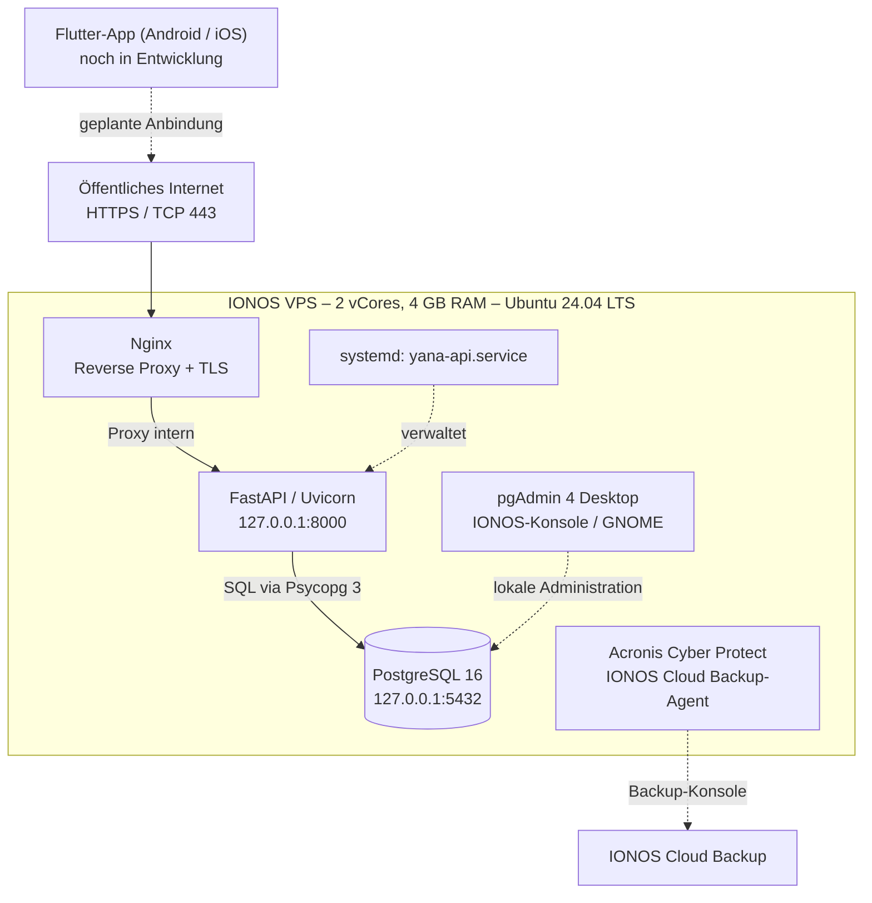
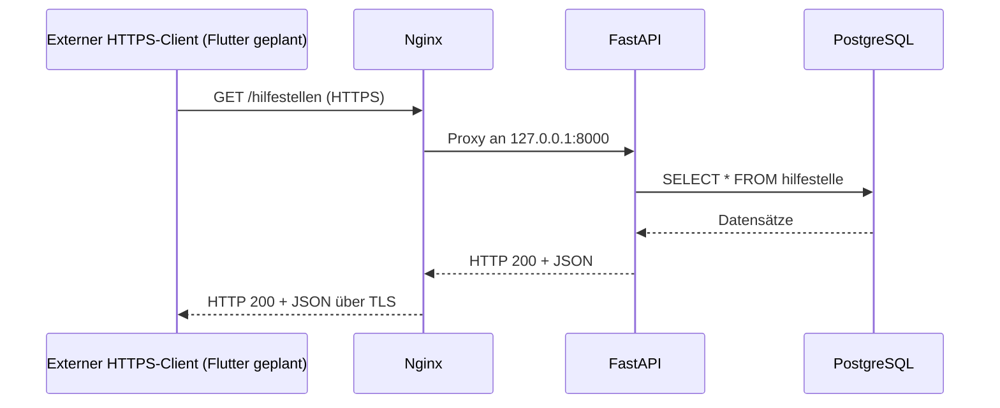

# Technische Systemarchitektur

## Architekturprinzip

Das YANA-System verwendet eine **Client-Server-Architektur**. Die Flutter-App ist als mobiler Client vorgesehen; das Python-Backend bietet HTTP/JSON-Endpunkte, Nginx terminiert TLS und PostgreSQL verwaltet die persistenten Daten. **Der Flutter-Client wurde bis zum dokumentierten Stand noch nicht angebunden.**

**Hinweis:** Ein erfolgreicher Backup-Lauf ist noch gesondert nachzuweisen. Der mobile Zugriff über Flutter ist in der Abbildung als **geplante** Verbindung markiert, nicht als bereits abgeschlossen.

## Komponenten und Verantwortlichkeiten

| Komponente | Verantwortlichkeit | Vertrauensgrenze |
|---|---|---|
| Flutter/Dart | Oberfläche, Eingaben, Darstellung empfangener JSON-Daten | Öffentliches Endgerät, künftig anzubinden |
| Nginx | HTTPS-Zugang über Port 443, Weiterleitung an lokales Backend | Öffentlich zugängliche Serverkomponente |
| FastAPI/Uvicorn | API-Routing, DB-Abfragen, HTTP-Antworten | Lokal `127.0.0.1:8000` |
| PostgreSQL | Datenintegrität, persistente Speicherung, relationale Verknüpfungen | Lokal `127.0.0.1:5432` |
| pgAdmin Desktop | Administration und SQL-Ausführung | Lokale GNOME-Sitzung auf VPS |
| systemd | Autostart und Neustart des API-Prozesses | Lokales Betriebsmanagement |
| Certbot | Ausstellung und Erneuerung des IP-TLS-Zertifikats | ACME-HTTP-Prüfung über Port 80 |
| Backup-Agent | Registrierung des VPS in der IONOS Backup-Konsole | Backup-Infrastruktur |

## Beispiel-Datenfluss: Hilfestellen abrufen

Der Ablauf wurde bis zur HTTPS-API mit Browser/Swagger tatsächlich erprobt; nur die spätere Ausführung durch Flutter fehlt.

## Projektverzeichnis und Konfigurationspfade

| Pfad | Inhalt |
|---|---|
| `/home/yana/yana-backend/main.py` | FastAPI-Endpunkte |
| `/home/yana/yana-backend/database.py` | PostgreSQL-Verbindungsfunktion |
| `/home/yana/yana-backend/.env` | DB-Zugangsdaten, **nicht veröffentlichen** |
| `/home/yana/yana-backend/.venv/` | Virtuelle Python-Umgebung |
| `/etc/systemd/system/yana-api.service` | API-Dienstdefinition |
| `/etc/nginx/sites-available/yana-api` | Lokaler Reverse Proxy + HTTPS |
| `/etc/nginx/sites-available/yana-acme` | HTTP-01-Challenge-Endpunkt |
| `/var/www/yana-acme/` | ACME-Webroot |
| `/etc/letsencrypt/live/SERVER_IP/` | Zertifikatsdateien und privater Schlüssel |
| `/etc/letsencrypt/renewal-hooks/deploy/reload-nginx.sh` | Nginx-Neuladen nach Erneuerung |

Beim Benutzer- und Home-Pfad handelt es sich um den bisherigen VPS-Zustand. Bei anderen Servern müssen die Pfade angepasst werden.

## Technologiewahl und Einschränkungen

Die Entscheidung für FastAPI statt einer selbst gehosteten vollständigen Supabase-Umgebung beruht auf dem begrenzten VPS-Ressourcenbudget und dem Wunsch nach einer schlanken, direkt kontrollierten REST-API. FastAPI **ersetzt nur die benötigten Backend-Funktionen**; Supabase-Funktionen wie Authentifizierung, Realtime, Storage und integrierte Policies werden **nicht automatisch** mitgeliefert. Sie müssen bei Bedarf eigenständig konzipiert werden. Siehe [Entscheidungen](entscheidungen.md) und [Sicherheit](betrieb-sicherheit.md).
