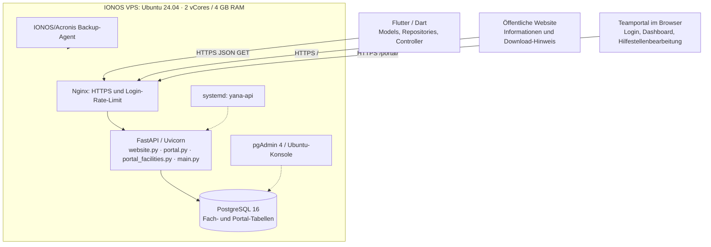
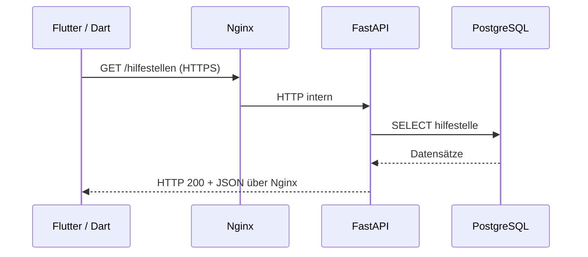

# Technische Systemarchitektur

**Stand: 17.11.2026**

## 1. Architekturprinzip

YANA verwendet eine **Client-Server-Architektur** mit gemeinsamem FastAPI-Backend und PostgreSQL-Datenbank. Es gibt drei wichtige Clients: die Flutter-App, die **öffentliche HTML-Website** und den **geschützten Browserzugang zum Teamportal**. Nginx terminiert HTTPS; der Backend-Dienst wird über `systemd` betrieben.



Die Website und das Portal werden nicht auf einem zweiten Webserver betrieben; sie verwenden denselben FastAPI-Prozess wie die REST-API. **Die Datenbank ist nicht öffentlich erreichbar.** Die getrennte Test-Codekopie greift derzeit auf dieselbe DB zu; diese Einschränkung wird unter [Portal-Tests](teamportal-tests.md) erläutert.

## 2. Verantwortlichkeiten

| Komponente | Aufgabe | Bestätigter Stand |
|---|---|---|
| Flutter | App-Oberfläche (in Entwicklung), Datenabruf und Zustandsverwaltung | GET-Datenzugriff/Controller/Tests implementiert |
| Website/Jinja2 | Informationsseiten unter `/`, statische Dateien | Produktiv im Browser getestet |
| Portal/Jinja2 | Login, Dashboard, Hilfestellenverwaltung | Produktiv im Browser getestet |
| FastAPI | Routing, Session-Prüfung, SQL-Operationen, JSON-Ausgabe | Funktioniert für vorhandene Routen |
| PostgreSQL | Acht ursprüngliche Fach-/Chat-Tabellen plus drei Portal-Tabellen | Schema und Speichertest nachgewiesen |
| Nginx | HTTPS, Weiterleitung, Rate-Limit für Login | Konfiguration geprüft und aktiv |
| systemd | Start/Neustart von `yana-api` | Aktiv |
| Certbot | IP-TLS-Zertifikat und Erneuerung | Zertifikat und Dry-Run bestätigt |
| Backup-Agent | Backup-Infrastruktur | Installiert/registriert; vollständiger Restore-Test offen |

## 3. Typische Datenflüsse

### Flutter liest Hilfestellen



Bei Flutter Web in Chrome muss außerdem die CORS-Origin erlaubt sein. Für lokale `localhost`-/`127.0.0.1`-Entwicklungsports wurde `CORSMiddleware` in `main.py` ergänzt.

### Teammitglied ändert Hilfestelle

Das Teamportal verwendet ein signiertes Cookie mit zufälliger Session-ID. FastAPI verifiziert den zugehörigen Hash in `portal_session`, die Account-Rolle und beim POST den CSRF-Token. Die Zeile in `hilfestelle` wird mit `SELECT ... FOR UPDATE` gesperrt. Das SQL-UPDATE und der Eintrag in `portal_facility_audit` werden gemeinsam als Transaktion durchgeführt. Anschließend gibt FastAPI HTTP 303 zur Bearbeitungsseite zurück. Mehr: [Hilfestellenverwaltung](teamportal-hilfestellen.md).

## 4. Repository- und Serverstruktur

```text
YANA-A-B-S/
├── apps/mobile/             # Flutter
├── services/api/            # FastAPI + Website/Portal
├── docs/                    # Diese MkDocs-Dokumentation
└── mkdocs.yml               # Navigation und Site-Konfiguration

IONOS VPS:
~/yana-deploy-source/       # GitHub-Klon (Entwicklungsversion)
~/yana-portal-test/          # Python-Testkopie
~/yana-backend/              # Produktiver FastAPI-Code, .venv, .env
/etc/systemd/system/yana-api.service
/etc/nginx/...
```

Es wurde bewusst **nicht** für jede Weboberfläche ein neues Backend oder eine zweite PostgreSQL-Instanz eingeführt. Dies vereinfacht den Einstieg, verlangt jedoch konsequente Rollenprüfung und vorsichtige Releases.

## 5. Technologische und fachliche Grenzen

- Die öffentliche `/hilfestellen`-API kann weiterhin Standortangaben enthalten; Schutzunterkünfte vor Aufnahme realer Datensätze besonders behandeln.
- Accounts für externe Organisationen sind noch nicht an ihre eigenen Einrichtungen gebunden.
- Noch keine Veröffentlichungsgenehmigung, kein „Neue Hilfestelle anlegen“, keine freigegebenen realen Notfallangebote.
- Technische Logik in Flutter ist getestet, vollständige sichtbare App-Screens noch nicht als fertig nachgewiesen.
- Es gibt noch keinen isolierten Staging-Datenbankbetrieb und keinen automatisierten CI-/Deployment-Prozess.

Verweise: [Teamportal-Architektur](teamportal-architektur.md), [Entscheidungen](entscheidungen.md), [Betrieb und Sicherheit](betrieb-sicherheit.md) und [Wiedereinstieg](weiterarbeit.md).
