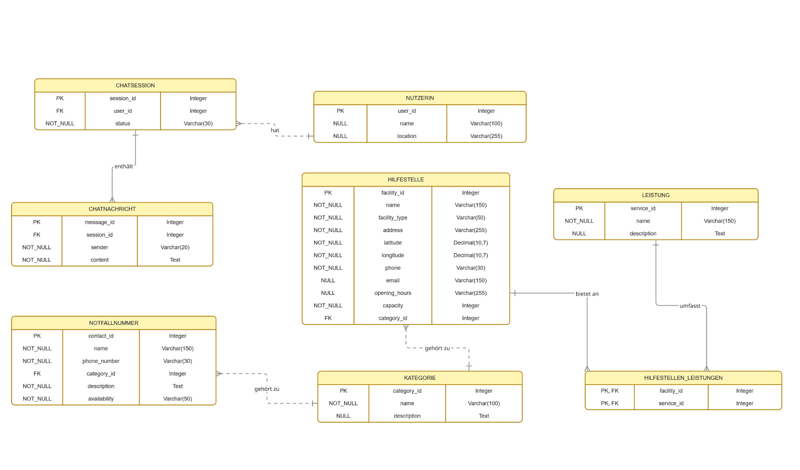
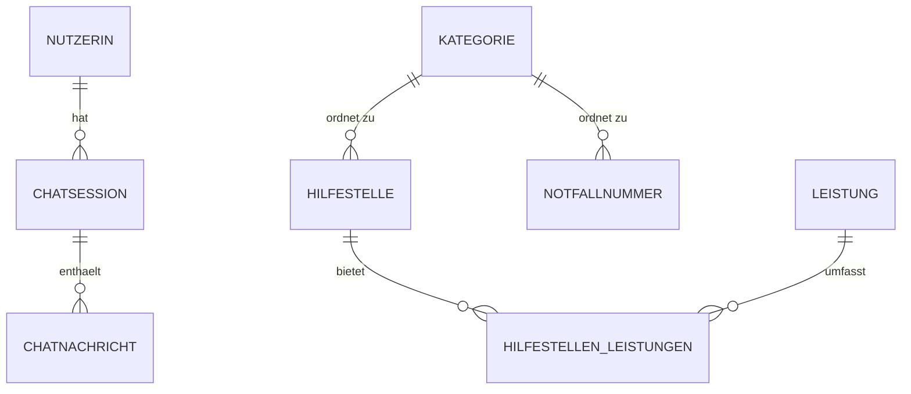

# Datenmodell und PostgreSQL-Schema



*Abbildung: ursprünglich von der Projektgruppe bereitgestelltes YANA-ER-Modell.*

## Grundlage

Das relationale Modell orientiert sich am im Projekt erstellten ER-Modell. Es umfasst **acht Tabellen**. Die Primärschlüssel der Stammtabellen werden automatisch über PostgreSQL-Identity-Spalten erzeugt. Die Zuordnung von Hilfestellen zu Leistungen ist eine **n:m-Beziehung** mit zusammengesetztem Primärschlüssel.

## Tabellenübersicht

| Tabelle | Zweck | Primärschlüssel | Fremdschlüssel |
|---|---|---|---|
| `nutzerin` | Nutzerinnen (Testmodell) | `user_id` | – |
| `chatsession` | Chat-Sitzungen | `session_id` | `user_id → nutzerin` |
| `chatnachricht` | Nachrichten | `message_id` | `session_id → chatsession` |
| `kategorie` | Hilfs-/Kontaktkategorien | `category_id` | – |
| `hilfestelle` | Hilfsorganisationen und Standorte | `facility_id` | `category_id → kategorie` |
| `notfallnummer` | Notfallkontakte | `contact_id` | `category_id → kategorie` |
| `leistung` | Hilfsleistungen | `service_id` | – |
| `hilfestellen_leistungen` | Zuordnung Hilfestelle ↔ Leistung | `(facility_id, service_id)` | `facility_id → hilfestelle`, `service_id → leistung` |



Die Übersicht stellt die fachliche 1:n-Zuordnung vereinfacht dar. In der aktuellen Implementierung sind einige FK-Felder (`user_id`, `session_id`, `category_id`) **NULL-fähig** und die Datenbank erzwingt folglich nicht in jedem Fall eine tatsächliche Zuordnung.

## Vollständiges Schema (IST-Implementierung)

Im pgAdmin-Query-Tool wurde folgendes SQL **in der leeren Datenbank** ausgeführt. Für erneutes Deploying ist es als Ausgangsschema zu verstehen: `CREATE TABLE` ohne `IF NOT EXISTS` schlägt bei bereits vorhandenen Tabellen fehl.

```sql
BEGIN;

CREATE TABLE nutzerin (
    user_id INTEGER GENERATED BY DEFAULT AS IDENTITY PRIMARY KEY,
    name VARCHAR(100),
    location VARCHAR(255)
);

CREATE TABLE chatsession (
    session_id INTEGER GENERATED BY DEFAULT AS IDENTITY PRIMARY KEY,
    user_id INTEGER,
    status VARCHAR(30) NOT NULL,
    CONSTRAINT fk_chatsession_nutzerin
      FOREIGN KEY (user_id) REFERENCES nutzerin(user_id)
);

CREATE TABLE chatnachricht (
    message_id INTEGER GENERATED BY DEFAULT AS IDENTITY PRIMARY KEY,
    session_id INTEGER,
    sender VARCHAR(20) NOT NULL,
    content TEXT NOT NULL,
    CONSTRAINT fk_chatnachricht_session
      FOREIGN KEY (session_id) REFERENCES chatsession(session_id)
);

CREATE TABLE kategorie (
    category_id INTEGER GENERATED BY DEFAULT AS IDENTITY PRIMARY KEY,
    name VARCHAR(100) NOT NULL,
    description TEXT
);

CREATE TABLE hilfestelle (
    facility_id INTEGER GENERATED BY DEFAULT AS IDENTITY PRIMARY KEY,
    name VARCHAR(150) NOT NULL,
    facility_type VARCHAR(50) NOT NULL,
    address VARCHAR(255) NOT NULL,
    latitude DECIMAL(10,7) NOT NULL,
    longitude DECIMAL(10,7) NOT NULL,
    phone VARCHAR(30),
    email VARCHAR(150),
    opening_hours VARCHAR(255),
    capacity INTEGER NOT NULL,
    category_id INTEGER,
    CONSTRAINT fk_hilfestelle_kategorie
      FOREIGN KEY (category_id) REFERENCES kategorie(category_id)
);

CREATE TABLE notfallnummer (
    contact_id INTEGER GENERATED BY DEFAULT AS IDENTITY PRIMARY KEY,
    name VARCHAR(150) NOT NULL,
    phone_number VARCHAR(30) NOT NULL,
    category_id INTEGER,
    description TEXT NOT NULL,
    availability VARCHAR(50) NOT NULL,
    CONSTRAINT fk_notfallnummer_kategorie
      FOREIGN KEY (category_id) REFERENCES kategorie(category_id)
);

CREATE TABLE leistung (
    service_id INTEGER GENERATED BY DEFAULT AS IDENTITY PRIMARY KEY,
    name VARCHAR(150) NOT NULL,
    description TEXT
);

CREATE TABLE hilfestellen_leistungen (
    facility_id INTEGER,
    service_id INTEGER,
    PRIMARY KEY (facility_id, service_id),
    CONSTRAINT fk_hl_hilfestelle
      FOREIGN KEY (facility_id) REFERENCES hilfestelle(facility_id),
    CONSTRAINT fk_hl_leistung
      FOREIGN KEY (service_id) REFERENCES leistung(service_id)
);

COMMIT;
```

### Datentypen und Modellierungsentscheidungen

- `INTEGER GENERATED BY DEFAULT AS IDENTITY` – automatische Vergabe einer fortlaufenden ID, manuelle Zuweisung bleibt möglich.
- `VARCHAR(n)` – begrenzt die Länge von Namen, Status und Kontaktfeldern.
- `DECIMAL(10,7)` – geografische Koordinaten als Dezimalzahlen, noch **ohne** PostGIS.
- `TEXT` – längere Beschreibungen und Nachrichten.
- `NOT NULL` – zwingend anzugebende Werte; Felder ohne `NOT NULL` sind optional.
- Fremdschlüssel – sichern konsistente Verweise auf referenzierte Datensätze.

## Testdaten (Entwicklungszwecke)

Für die erste API-Verifikation wurden zwei fiktive Kategorien, zwei fiktive Hilfestellen und zwei Leistungen eingefügt. Anschließend wurden die Hilfestellen und Leistungen über die n:m-Tabelle verknüpft:

```sql
BEGIN;

INSERT INTO kategorie (category_id, name, description) VALUES
  (1, 'Frauenberatung', 'Beratungsangebote für Frauen'),
  (2, 'Schutzunterkunft', 'Schutz und vorübergehende Unterbringung');

INSERT INTO hilfestelle (
  facility_id, name, facility_type, address, latitude, longitude,
  phone, email, opening_hours, capacity, category_id
) VALUES
  (1, 'YANA Test-Beratungsstelle', 'Beratungsstelle',
      'Musterstraße 1, Regensburg', 49.0134, 12.1016,
      NULL, NULL, 'Mo-Fr 09:00-17:00 (Testdaten)', 10, 1),
  (2, 'YANA Test-Schutzunterkunft', 'Schutzunterkunft',
      'Teststandort, Regensburg', 49.0200, 12.0900,
      NULL, NULL, 'Nur nach Vereinbarung (Testdaten)', 5, 2);

INSERT INTO leistung (service_id, name, description) VALUES
  (1, 'Psychosoziale Beratung', 'Unterstützung und Beratung'),
  (2, 'Schutzunterbringung', 'Vorübergehende sichere Unterkunft');

INSERT INTO hilfestellen_leistungen (facility_id, service_id) VALUES
  (1, 1), (2, 2);

COMMIT;
```

**Nur einmal in der leeren Datenbank ausführen.** Die Adressen, Kapazitäten und Öffnungszeiten sind frei erfundene Testangaben, **keine verifizierten realen Hilfsangebote**. Reale Schutzunterkünfte dürfen nicht ungeprüft mit möglicherweise vertraulichen Adressen veröffentlicht werden.

**Technischer Nachtrag:** Da die Testdaten explizite IDs verwenden, kann beim nächsten Insert mit automatisch generierter ID die Identity-Sequenz hinter dem maximal vorhandenen Wert liegen. Vor weiteren Inserts sollte der aktuelle Sequenzstand geprüft und ggf. angepasst werden. Beispiel für die drei bislang manuell gesetzten Identity-Spalten:

```sql
SELECT setval(pg_get_serial_sequence('kategorie', 'category_id'),
              (SELECT MAX(category_id) FROM kategorie), true);
SELECT setval(pg_get_serial_sequence('hilfestelle', 'facility_id'),
              (SELECT MAX(facility_id) FROM hilfestelle), true);
SELECT setval(pg_get_serial_sequence('leistung', 'service_id'),
              (SELECT MAX(service_id) FROM leistung), true);
```

Dies ist eine **empfohlene Nacharbeit**, nicht bereits bestätigter Einrichtungsschritt.

## Fachliche und sicherheitsrelevante Weiterentwicklung

- Für Chatdaten fehlen noch Zeitstempel und ein differenziertes Rollen-/Löschkonzept.
- Standortdaten von Nutzerinnen können sensibel sein; Notwendigkeit und Speicherfrist müssen hinterfragt werden.
- `capacity` ist derzeit obligatorisch; das ist für Beratungsstellen möglicherweise nicht fachgerecht.
- Öffnungszeiten werden aktuell als freier Text gespeichert.
- Filterung nach Nähe wird noch nicht implementiert; dafür sind präzise Datenvalidierung und ggf. Geodatenindexierung erforderlich.
- Das Datenmodell allein bildet **keine** Autorisierung ab. Authentifizierung und Berechtigungsregeln müssen im Backend implementiert werden.
