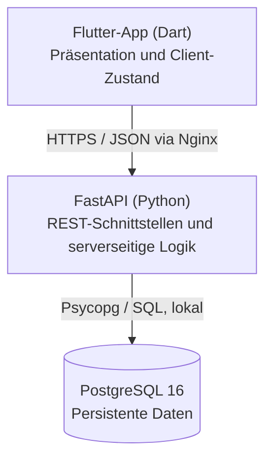
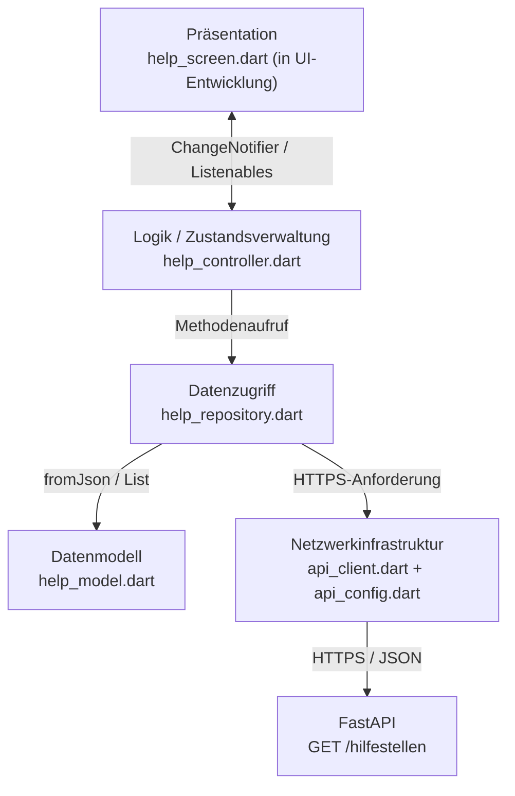

# Flutter-Architektur: Drei Schichten und Verantwortlichkeiten

**Stand: 27. Oktober 2026 · Implementiert: Datenzugriff und Controller · In Arbeit: UI**

## 1. Drei-Schichtenmodell im Gesamtsystem

YANA trennt die Client-Darstellung, die serverseitige Anwendung und die persistente Datenhaltung:



Die **serverseitige Geschäftsschicht** liegt bei FastAPI. Flutter erhält **keine direkten Datenbankzugangsdaten**. Datenbanktabellen und Schlüssel werden durch PostgreSQL verwaltet. Die Flutter-Anwendung besitzt daneben eine **interne Aufteilung** in Darstellung, UI-/Anwendungslogik und Datenzugriff. Diese Client-internen Schichten sind keine zusätzlichen physischen Server-Tiers.

## 2. Drei Schichten innerhalb von Flutter



| Baustein | Schicht bzw. Funktion | Verantwortlich für | Nicht verantwortlich für |
|---|---|---|---|
| `*_screen.dart` | Präsentation | Widgets, Layout, Nutzerinteraktion, Anzeige | SQL/HTTP |
| `*_controller.dart` | Logik | Laden, Lade-/Fehlerzustand, Benachrichtigung der UI | HTTP-Details / JSON-Parsing |
| `*_repository.dart` | Datenzugriff | Auswahl eines API-Endpunkts, Transformation in Models | Widgets / Navigation |
| `*_model.dart` | Datenvertrag | Typisierte Felder, `fromJson` | Netzwerk / UI |
| `api_client.dart` | Gemeinsame Infrastruktur | HTTP GET, Timeout, UTF-8, JSON, Statusprüfung | Fachliche Datentypen |
| `api_config.dart` | Konfiguration | Basisadresse des Backends | Geheimnisse |

Das `Model` ist ein Datenobjekt **innerhalb der Client-Datenverarbeitung**, keine vierte Serverkomponente. Die Datenbanktabellen werden nur serverseitig angesprochen.

## 3. Verzeichnisstruktur im Monorepo

Der folgende Ausschnitt enthält die **umgesetzten API- und Controller-Dateien**, die Diagnosewerkzeuge und die noch in Bearbeitung befindlichen Präsentationsdateien:

```text
YANA-A-B-S/
├── apps/
│   └── mobile/
│       ├── android/                      # Android-Hostprojekt
│       ├── ios/                          # iOS-Hostprojekt
│       ├── lib/
│       │   ├── main.dart                 # App-Einstieg; UI wird im Team entwickelt
│       │   ├── core/
│       │   │   ├── config/
│       │   │   │   └── api_config.dart
│       │   │   └── network/
│       │   │       └── api_client.dart
│       │   └── features/
│       │       ├── help/
│       │       │   ├── data/
│       │       │   │   ├── help_model.dart
│       │       │   │   └── help_repository.dart
│       │       │   └── logic/help_controller.dart
│       │       ├── category/
│       │       │   ├── data/
│       │       │   │   ├── category_model.dart
│       │       │   │   └── category_repository.dart
│       │       │   └── logic/category_controller.dart
│       │       └── emergency/
│       │           ├── data/
│       │           │   ├── emergency_model.dart
│       │           │   └── emergency_repository.dart
│       │           └── logic/emergency_controller.dart
│       ├── test/
│       │   ├── widget_test.dart
│       │   ├── help_controller_test.dart
│       │   ├── category_controller_test.dart
│       │   └── emergency_controller_test.dart
│       ├── tool/
│       │   ├── api_connection_test.dart
│       │   ├── category_connection_test.dart
│       │   └── emergency_connection_test.dart
│       ├── pubspec.yaml
│       └── pubspec.lock
├── services/api/                       # Für künftige Versionierung des Backends
├── docs/                               # MkDocs
└── infra/                              # Infrastruktur, soweit eingecheckt
```

**Hinweis zur Reproduzierbarkeit:** Dieser Ausschnitt ist aus den gemeinsam durchgeführten Entwicklungsschritten rekonstruiert. Er beschreibt den bestätigten Funktionsumfang, ist aber kein automatisch generierter Dateibaum eines aktuellen Git-Commits. Die tatsächlichen Implementierungsdateien liegen im Flutter-Repository und müssen bei späteren Änderungen synchron mit dieser Dokumentation gehalten werden.

## 4. Request- und Zustandsfluss

```mermaid
sequenceDiagram
    participant S as Flutter-Screen (noch einzubinden)
    participant C as HelpController
    participant R as HelpRepository
    participant H as ApiClient
    participant A as FastAPI
    participant D as PostgreSQL
    S->>C: loadFacilities()
    C-->>S: isLoading=true; notifyListeners()
    C->>R: getHelpFacilities()
    R->>H: get('/hilfestellen')
    H->>A: GET /hilfestellen (HTTPS)
    A->>D: SELECT * FROM hilfestelle
    D-->>A: 2 Testdatensätze
    A-->>H: HTTP 200 + JSON
    H-->>R: Dart JSON-Struktur
    R-->>C: List<HelpFacility>
    C-->>S: facilities gesetzt; isLoading=false; notifyListeners()
```

In einem Fehlerfall setzt der Controller stattdessen `errorMessage` und beendet den Ladezustand. Das UI soll den Zustand darstellen und eine erneute Anfrage ermöglichen. Der Controller **darf** keine Datenbank-SQL-Befehle ausführen.

## 5. Implementierte Controller-Schnittstellen

| Klasse | Methode | Öffentliche Properties |
|---|---|---|
| `HelpController` | `Future<void> loadFacilities()` | `facilities`, `isLoading`, `errorMessage` |
| `CategoryController` | `Future<void> loadCategories()` | `categories`, `isLoading`, `errorMessage` |
| `EmergencyController` | `Future<void> loadContacts()` | `contacts`, `isLoading`, `errorMessage` |

Alle drei Controller erweitern `ChangeNotifier`. Nach einer Zustandsänderung informieren sie registrierte Listener mit `notifyListeners()`. Ein `_disposed`-Flag vermeidet nach der Freigabe eines Controllers weitere Benachrichtigungen. Mehrere gleichzeitig angestoßene Ladevorgänge werden durch `_isLoading` vermieden. Die Listen werden durch `List.unmodifiable(...)` schreibgeschützt nach außen zurückgegeben.

### Lebenszyklus und Fehlerbehandlung

- Einen Controller **einmal pro Bildschirmzustand** erstellen, nicht bei jedem `build()`.
- Daten laden, z. B. in `initState()`; den Controller mit `ListenableBuilder` oder `AnimatedBuilder` beobachten.
- Bei `isLoading == true` einen Ladezustand anzeigen.
- Bei `errorMessage != null` eine verständliche Fehlermeldung mit Wiederholen-Aktion anbieten.
- Bei leerer Liste einen **leeren Zustand** zeigen, nicht automatisch einen Netzwerkfehler.
- In `dispose()` den Controller freigeben.
- Fehlermeldungen für Nutzerinnen generisch halten, technische Details kontrolliert in Entwicklungslogs dokumentieren.

### Beispiel für die UI-Übergabe (noch nicht als integrierte Bildschirmfunktion bestätigt)

```dart
late final HelpController _controller;

@override
void initState() {
  super.initState();
  _controller = HelpController();
  _controller.loadFacilities();
}

@override
void dispose() {
  _controller.dispose();
  super.dispose();
}
```

Dies ist **ein Auszug aus einem möglichen StatefulWidget**; er ersetzt keine vollständige Screen-Implementierung. Die Übergabe an die UI wird im [Team-Workflow](flutter-teamworkflow.md) erläutert.

## 6. Architekturgrenzen und offene Arbeiten

**Bestätigt umgesetzt:** drei Models, drei Repositories, drei Controller und ihre Live- bzw. Fake-Tests. **Noch nicht bestätigt:** Einbindung in die fertige App-Navigation, Offline-Caching, Rollen-/Rechtekonzept, Chat-Schnittstellen, Geo-Suche, serverseitige Filter und produktive Nutzung.

Weitere technische Risiken: Fehlender Offline-Fallback für Notfallkontakte, keine zentralen HTTP-Retry-/Backoff-Regeln, keine expliziten Response-Schemas im bisherigen FastAPI-Code, keine End-to-End-Tests auf einem echten Android-Gerät. Diese Punkte sind Aufgaben für spätere Iterationen und sollten nicht als bereits erledigt dargestellt werden.

Siehe [API-Anbindung und Datenmodelle](flutter-api-anbindung.md), [Testkonzept](flutter-tests.md) und [Systemarchitektur](architektur.md).
