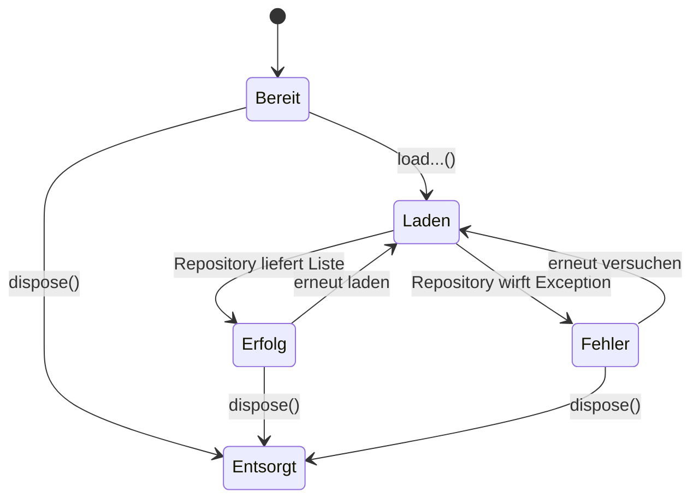

# Flutter-Logikschicht: Controller mit ChangeNotifier

**Stand: 27. Oktober 2026 · Alle drei Controller implementiert und durch Fake-Repository-Tests geprüft**

Die Models und Repositories aus der [API-Anbindung](flutter-api-anbindung.md) stellen typisierte Daten bereit. Für die spätere Oberfläche benötigen wir zusätzlich eine Logikschicht, die Daten lädt, einen Ladeindikator ermöglicht und Fehler verständlich aufbereitet. Dafür werden Flutter-Controller eingesetzt, die `ChangeNotifier` erweitern.

## 1. Gemeinsames Muster



- Die Liste startet leer.
- `isLoading` ist anfangs `false`.
- `errorMessage` ist anfangs `null`.
- Beim Aufruf von `load...()` wird der Ladezustand aktiv und `notifyListeners()` informiert später die UI.
- Nach erfolgreichem Laden werden die Daten übernommen, im Fehlerfall eine **neutrale** Fehlermeldung gesetzt.
- Nach Abschluss wird `isLoading` zurückgesetzt und erneut benachrichtigt.
- Ist der Controller bereits entsorgt (`_disposed`), erfolgen keine weiteren Benachrichtigungen.

## 2. Hilfestellen: `HelpController`

Pfad: `lib/features/help/logic/help_controller.dart`

```dart
import 'package:flutter/foundation.dart';

import '../data/help_model.dart';
import '../data/help_repository.dart';

class HelpController extends ChangeNotifier {
  final HelpRepository _repository;

  HelpController({HelpRepository? repository})
      : _repository = repository ?? HelpRepository();

  List<HelpFacility> _facilities = [];
  bool _isLoading = false;
  bool _disposed = false;
  String? _errorMessage;

  List<HelpFacility> get facilities => List.unmodifiable(_facilities);
  bool get isLoading => _isLoading;
  String? get errorMessage => _errorMessage;

  Future<void> loadFacilities() async {
    if (_isLoading || _disposed) return;

    _isLoading = true;
    _errorMessage = null;
    notifyListeners();

    try {
      final result = await _repository.getHelpFacilities();
      if (_disposed) return;
      _facilities = result;
    } catch (error) {
      if (_disposed) return;
      _errorMessage = 'Hilfestellen konnten nicht geladen werden.';
    } finally {
      if (!_disposed) {
        _isLoading = false;
        notifyListeners();
      }
    }
  }

  @override
  void dispose() {
    _disposed = true;
    super.dispose();
  }
}
```

Das `_` kennzeichnet Dart-Namen als **bibliotheksprivat**. Die Oberfläche soll `controller.facilities` abfragen und die interne Liste nicht eigenständig ersetzen. Durch `List.unmodifiable` wird sie nur lesbar nach außen gegeben.

**Detail aus der Entwicklung:** Eine zunächst genutzte Bedingung `if (!hasListeners && _disposed)` wurde zu `if (_disposed)` vereinfacht. `hasListeners` zeigt lediglich das Vorhandensein registrierter Listener und darf nicht über die Lebensdauer des Controllers entscheiden.

## 3. Kategorien: `CategoryController`

Pfad: `lib/features/category/logic/category_controller.dart`

```dart
import 'package:flutter/foundation.dart';

import '../data/category_model.dart';
import '../data/category_repository.dart';

class CategoryController extends ChangeNotifier {
  final CategoryRepository _repository;

  CategoryController({CategoryRepository? repository})
      : _repository = repository ?? CategoryRepository();

  List<YanaCategory> _categories = [];
  bool _isLoading = false;
  bool _disposed = false;
  String? _errorMessage;

  List<YanaCategory> get categories => List.unmodifiable(_categories);
  bool get isLoading => _isLoading;
  String? get errorMessage => _errorMessage;

  Future<void> loadCategories() async {
    if (_isLoading || _disposed) return;
    _isLoading = true;
    _errorMessage = null;
    notifyListeners();

    try {
      final result = await _repository.getCategories();
      if (_disposed) return;
      _categories = result;
    } catch (error) {
      if (_disposed) return;
      _errorMessage = 'Kategorien konnten nicht geladen werden.';
    } finally {
      if (!_disposed) {
        _isLoading = false;
        notifyListeners();
      }
    }
  }

  @override
  void dispose() {
    _disposed = true;
    super.dispose();
  }
}
```

**Typkonsistenz:** Der Modellname lautet `YanaCategory`, **nicht** `Category`. Sowohl die interne Liste als auch der Getter müssen `List<YanaCategory>` verwenden. Das Repository liefert ebenfalls `Future<List<YanaCategory>>`. Andernfalls entsteht der im Projekt beobachtete Typfehler `List<YanaCategory> can't be assigned to List<Category>`.

## 4. Notfallnummern: `EmergencyController`

Pfad: `lib/features/emergency/logic/emergency_controller.dart`

```dart
import 'package:flutter/foundation.dart';

import '../data/emergency_model.dart';
import '../data/emergency_repository.dart';

class EmergencyController extends ChangeNotifier {
  final EmergencyRepository _repository;

  EmergencyController({EmergencyRepository? repository})
      : _repository = repository ?? EmergencyRepository();

  List<EmergencyContact> _contacts = [];
  bool _isLoading = false;
  bool _disposed = false;
  String? _errorMessage;

  List<EmergencyContact> get contacts => List.unmodifiable(_contacts);
  bool get isLoading => _isLoading;
  String? get errorMessage => _errorMessage;

  Future<void> loadContacts() async {
    if (_isLoading || _disposed) return;
    _isLoading = true;
    _errorMessage = null;
    notifyListeners();

    try {
      final result = await _repository.getEmergencyContacts();
      if (_disposed) return;
      _contacts = result;
    } catch (error) {
      if (_disposed) return;
      _errorMessage = 'Notfallnummern konnten nicht geladen werden.';
    } finally {
      if (!_disposed) {
        _isLoading = false;
        notifyListeners();
      }
    }
  }

  @override
  void dispose() {
    _disposed = true;
    super.dispose();
  }
}
```

## 5. Controller im Flutter-Screen verwenden (Integrationsbeispiel)

Die Bildschirmintegration wurde noch nicht als abgeschlossen bestätigt. Nachfolgend ein **minimaler, eigenständiger Beispielscreen** für die Übergabe an die UI-Entwicklung. Die Startseite `main.dart` des Teammitglieds muss dazu **nicht** überschrieben werden.

```dart
import 'package:flutter/material.dart';
import '../logic/help_controller.dart';

class HelpScreen extends StatefulWidget {
  const HelpScreen({super.key});

  @override
  State<HelpScreen> createState() => _HelpScreenState();
}

class _HelpScreenState extends State<HelpScreen> {
  late final HelpController controller;

  @override
  void initState() {
    super.initState();
    controller = HelpController();
    controller.loadFacilities();
  }

  @override
  void dispose() {
    controller.dispose();
    super.dispose();
  }

  @override
  Widget build(BuildContext context) {
    return ListenableBuilder(
      listenable: controller,
      builder: (context, _) {
        if (controller.isLoading) {
          return const Center(child: CircularProgressIndicator());
        }
        if (controller.errorMessage != null) {
          return Center(
            child: Column(
              mainAxisSize: MainAxisSize.min,
              children: [
                Text(controller.errorMessage!),
                TextButton(
                  onPressed: controller.loadFacilities,
                  child: const Text('Erneut versuchen'),
                ),
              ],
            ),
          );
        }
        if (controller.facilities.isEmpty) {
          return const Center(child: Text('Keine Hilfestellen vorhanden.'));
        }
        return ListView.builder(
          itemCount: controller.facilities.length,
          itemBuilder: (context, index) {
            final facility = controller.facilities[index];
            return ListTile(
              title: Text(facility.name),
              subtitle: Text(facility.address),
            );
          },
        );
      },
    );
  }
}
```

Das Beispiel zeigt ausschließlich die prinzipielle **Controller-Nutzung**. Es ersetzt keine Produktdesign-Abstimmung, Tests auf mehreren Geräten oder ein Sicherheits-/Barrierefreiheitskonzept. Für die Projektdokumentation ist es ausdrücklich als *Beispiel, noch nicht produktiv integriert* markiert.

## 6. Tests und Grenzen

Controller werden **mit Fake-Repositories** geprüft. Ein Fake liefert vorbereitete Objekte bzw. wirft gezielt eine Exception. Dadurch können die Zustandsübergänge reproduzierbar getestet werden, ohne Netzverkehr. Für alle drei Controller wurden die Fälle **Startzustand, Erfolg und Fehlerfall** erfolgreich ausgeführt. Siehe [Teststrategie](flutter-tests.md).

Ein noch zu behebender fachlicher Punkt: Nach einem späteren Ladefehler kann ein Controller die zuletzt erfolgreiche Liste weiterhin vorhalten. Das UI muss entscheiden, ob diese Daten als *veraltet* kenntlich gemacht oder bei einem Fehler geleert werden sollen. Weitere offene Aspekte sind Filter, Sortierung, Offline-Nutzung und mögliche serverseitige Pagination.
