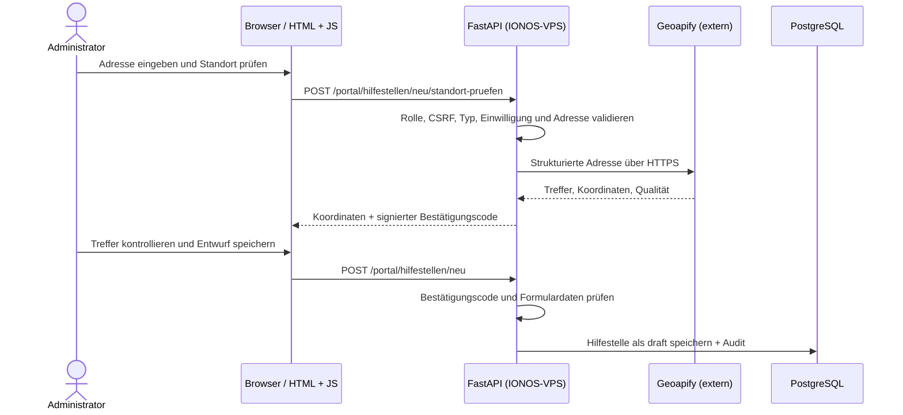

# Automatische Adresseingabe und Geoapify-Geocoding

**Stand: 24. November 2026 · Implementiert und in der VPS-Testumgebung geprüft. Produktive Veröffentlichung der neuen Adresseingabe bei diesem Dokumentations-Checkpoint noch nicht bestätigt.**

## Ziel und Abgrenzung

Beim **Anlegen einer neuen Hilfestelle** müssen Administratoren nicht mehr selbst geografische Koordinaten recherchieren. Sie erfassen stattdessen **Straße, Hausnummer, Postleitzahl und Ort**. YANA ermittelt auf bewussten Klick die Koordinaten und lässt den Treffer bestätigen. Das weiß-lila YANA-Design bleibt erhalten.

Geocoding ist **nicht** die Kartenansicht: Die einmalige Ermittlung erfolgt über den externen Anbieter **Geoapify**; die Koordinaten werden anschließend in PostgreSQL gespeichert. Normale Karten- und API-Aufrufe benötigen keine erneute Anfrage an Geoapify.

## Architektur und Datenfluss



**Ressourcen:** Die rechenintensive Adresssuche läuft extern. Der VPS verarbeitet eine kleine HTTPS-Anfrage und die JSON-Antwort. Für die prototypische Nutzung ist kein eigener Geocoding-Datenbestand erforderlich.

## Technische Bausteine

| Datei | Funktion |
|---|---|
| `services/api/geocoding_service.py` | Validierung/Normalisierung von Adressen, Abfrage bei Geoapify, Trefferprüfung und Bestätigungscode |
| `services/api/portal_facilities_create.py` | Geschützter Prüf-Endpunkt und Speicherung neuer Entwürfe |
| `services/api/templates/portal/hilfestellen_neu.html` | Strukturierte Adresseingabe und Bestätigungsanzeige |
| `services/api/static/js/yana-geocoding.js` | Geocoding-Anfrage aus der Eingabemaske auf Klick |
| `services/api/static/css/style.css` | Weiß-lila YANA-Design der neuen Eingaben |
| `services/api/templates/base.html` | Gemeinsames Layout und Einbindung benötigter Assets |

Der neue Endpunkt lautet:

| Methode | Route | Besonderheit |
|---|---|---|
| `POST` | `/portal/hilfestellen/neu/standort-pruefen` | Nur berechtigter Administrator, CSRF; Geocoding nur bei nicht vertraulichem Einrichtungstyp und ausdrücklicher Zustimmung |
| `GET` / `POST` | `/portal/hilfestellen/neu` | Adressformular und Erstellung eines `draft`-Eintrags, bestätigte Koordinaten optional |

Die Geoapify-Antwort enthält Standortkoordinaten und eine Bewertung der Trefferqualität. Das Backend akzeptiert nur ausreichend genaue, zur Adresse passende Ergebnisse, insbesondere die passende Hausnummer. Ein signierter, befristeter **`confirmation_token`** bindet die Standortbestätigung an die geprüften Eingabedaten. Manipulierte Hausnummern bzw. Tokens werden abgewiesen. Die Koordinaten dürfen nicht nur aus frei editierbaren HTML-Feldern übernommen werden.

## Datenbankschema und Verhalten

Die vorhandene Tabelle `hilfestelle` behält die Felder `address`, `latitude` und `longitude`. Die Koordinatenspalten dürfen inzwischen `NULL` sein; die zusätzliche CHECK-Bedingung `chk_yana_coordinates_complete` lässt **entweder beide Werte oder keinen Wert** zu.

| Situation | Speichervorgang |
|---|---|
| Adresse erfolgreich geprüft und bestätigt | Vollständige Adresse und ermittelte Koordinaten speichern |
| Kein Treffer / Dienst nicht verfügbar / Geocoding übersprungen | Entwurf **ohne** Koordinaten speichern; niemals Ersatzwerte wie `0,0` |
| Vertrauliche Einrichtung (z. B. Schutzunterkunft) | Keine externe Adressabfrage; falls erforderlich, getrennten internen Prozess entwickeln |
| Neuer Entwurf | `publication_status = 'draft'`, `is_location_public = FALSE` |

Die automatisch ermittelten Koordinaten sind **nicht automatisch öffentlich**. Für eine spätere öffentliche Ausgabe ist weiterhin die unabhängige [Standortfreigabe](standort-datenschutz.md) erforderlich.

## Konfiguration

Der API-Schlüssel steht ausschließlich auf dem VPS in einer geschützten `.env`-Datei:

```dotenv
GEOAPIFY_API_KEY=<API_SCHLUESSEL_NICHT_IN_GITHUB>
```

**Keine echten Schlüssel in MkDocs, GitHub, Screenshots oder Protokolle übernehmen.** Der Testcode lädt die `.env` unter `~/yana-portal-test/.env` mit einem **expliziten Pfad**, weil automatische Pfadsuche bei per Heredoc gestarteten Python-Skripten zu einer Ausnahme führen kann.

!!! warning "Externe Datenübermittlung"
    Bei der Geoapify-Abfrage verlässt die angegebene Adresse den IONOS-VPS. Die externe Abfrage ist nur für nicht vertrauliche Standorte vorgesehen. Eine Auswahl im Frontend allein reicht nicht: Die Beschränkung muss im Backend durchgesetzt werden. Für reale Hilfseinrichtungen sind Zweck, Rechtsgrundlage, Veröffentlichungsberechtigung und Anbieterbedingungen gesondert zu prüfen.

## Nachgewiesene Tests (24.11.2026)

Im VPS-Testverzeichnis `~/yana-portal-test` wurden nach Nutzerbestätigung erfolgreich ausgeführt:

1. `.env` geladen und Geoapify-Modul importiert.
2. **Echte Geoapify-Anfrage** für eine öffentlich bekannte Adresse in Regensburg: plausibles Ergebnis mit Koordinaten.
3. FastAPI-/TestClient-Ablauf: Administratorlogin, neue Eingabemaske, JavaScript, gesperrte Schutzunterkunft, erforderliche Zustimmung, externe Abfrage, signierter Code und öffentliche API.
4. Speichertest: fiktive Beratungsstelle **mit** bestätigten Koordinaten als Entwurf gespeichert; Audit und `is_location_public=FALSE` kontrolliert.
5. Speichertest: fiktiver Entwurf **ohne** Koordinaten erfolgreich.
6. Manipulierter Standortbeleg (veränderte Hausnummer) mit **HTTP 422** abgewiesen.
7. Schreibtests in einer offenen PostgreSQL-Transaktion durchgeführt und anschließend `ROLLBACK`; Testdatensätze sind nicht dauerhaft gespeichert. PostgreSQL-Sequenzwerte können dabei trotzdem fortschreiten.

**Wichtig:** Diese Nachweise belegen die **Testumgebung**, nicht automatisch die Bereitstellung des neuen Features im systemd-Produktivdienst. Der letzte dokumentierte Schritt ist der erfolgreiche Speichertest. Die anschließenden Deployment-Schritte wurden beschrieben, aber **noch nicht als abgeschlossen bestätigt**.

## Nächster Arbeitsschritt

Beim nächsten Entwicklungstermin ab **[Wiedereinstieg](weiterarbeit.md)** fortfahren:

1. Vorhandenen Dienst/`WorkingDirectory` und produktive Konfiguration kontrollieren.
2. Produktives Backup der betroffenen Dateien erstellen.
3. `GEOAPIFY_API_KEY` sicher in `~/yana-backend/.env` hinterlegen (kein GitHub).
4. Die **sechs zusammengehörigen, getesteten Dateien** aus `~/yana-portal-test` in `~/yana-backend` übernehmen.
5. Python-Syntax, FastAPI-Import und schreibfreie Endpunkte prüfen.
6. `sudo systemctl restart yana-api`, Dienststatus und HTTPS-/Browserfunktion prüfen.
7. Später die **Bearbeitung bestehender Hilfestellen** konsistent auf die neue Adresseingabe umstellen und Flutter-Verhalten bei `null`-Koordinaten testen.

Bei Fehlermeldungen nicht unkontrolliert fortfahren oder Migrationen wiederholen; Logs und Versionsstände kontrollieren. Siehe [Portal-Deployment](teamportal-deployment.md).
