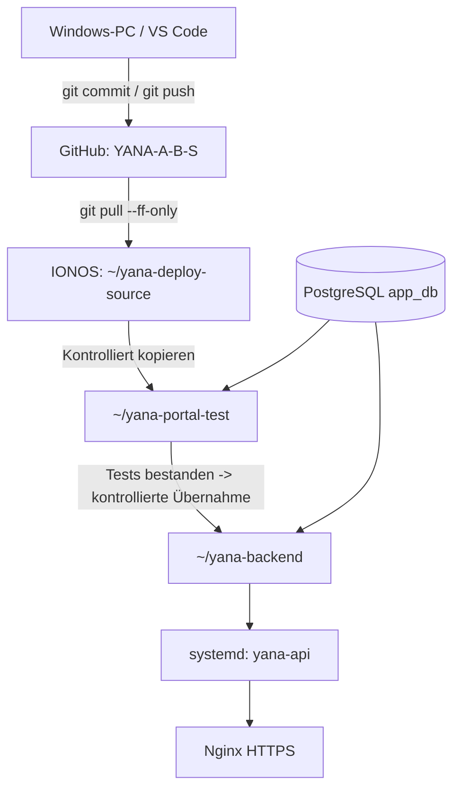

# GitHub, Teamarbeit und Deployment-Ablauf

**Dokumentationsstand: 17. November 2026**

## 1. Was liegt wo?



GitHub speichert den Quellcode, **nicht** die laufende Website und **nicht** die produktive PostgreSQL-Datenbank. Die HTML-, CSS-, Python- und Template-Dateien werden auf dem VPS zur Ausführung bereitgestellt. In der aktuellen Projektphase erfolgt das Deployment **manuell und kontrolliert**, nicht automatisch über GitHub Actions.

| Bereich | Pfad/Ort |
|---|---|
| Flutter | `apps/mobile/` im Repository |
| FastAPI + Website + Teamportal | `services/api/` im Repository |
| MkDocs | `docs/` im Repository; Konfiguration in `mkdocs.yml` |
| Git-Checkout auf VPS | `~/yana-deploy-source/` |
| Unabhängiger Python-Testcode | `~/yana-portal-test/` |
| Laufender Dienstcode | `~/yana-backend/` |
| Passwörter/DB-Konfiguration | `.env` ausschließlich lokal auf VPS |
| Datenbank | PostgreSQL-Cluster auf dem VPS |

## 2. Normaler Entwicklungsworkflow (Windows / PowerShell)

```powershell
# Im Repository-Hauptordner
 git status
 git pull --ff-only origin main
 # Änderungen bearbeiten und lokal prüfen
 git add services/api/portal_facilities.py services/api/templates/portal/
 git diff --cached
 git commit -m "Describe specific portal change"
 git pull --rebase origin main
 git push origin main
```

**Teamregel:** Vor einem Rebase prüfen, ob ungesicherte Arbeitskopie-Änderungen vorhanden sind. Bei einem Konflikt nicht mit `push --force` überschreiben, sondern den Konflikt bewusst auflösen oder `git rebase --abort` verwenden. Für parallele Features empfehlen sich eigene Branches und Pull Requests statt ständiger direkter Commits auf `main`.

## 3. Tatsächlich aufgetretene Git-Probleme

| Problem | Ursache / Lösung |
|---|---|
| `! [rejected] main -> main (non-fast-forward)` | GitHub war durch ein Teammitglied neuer. Mit sauberem lokalen Stand `git pull --rebase origin main`, danach erneut `git push origin main` |
| `Changes not staged: services/api/__pycache__/*.pyc` | Python hatte beim Syntaxcheck Bytecode erzeugt; Dateien waren fälschlich versioniert |
| Wiederholte Cache-Änderungen | `.gitignore` im Repository-Root ergänzt; bereits getrackte Cache-Dateien mit `git rm --cached -r -- services/api/__pycache__/` entfernt |
| `flutter.bat test`: `No pubspec.yaml file found` | Befehl aus Repository-Root statt aus `apps/mobile/` ausgeführt; für Flutter ins richtige Unterverzeichnis wechseln |
| Änderungen auf GitHub nicht auf der öffentlichen Website sichtbar | Ein GitHub-Push ist **kein Deployment**; VPS-Arbeitskopie und Produktionsdateien müssen separat aktualisiert werden |

## 4. Repository-Root: `.gitignore`

Die `.gitignore` wurde im **Hauptverzeichnis** von `YANA-A-B-S` erstellt/ergänzt. Neben der Flutter-spezifischen Datei unter `apps/mobile/` sorgt sie projektweit für das Ignorieren von Python-Cache, virtuellen Umgebungen, Secrets und temporären Dateien.

```gitignore
__pycache__/
*.py[cod]
.venv/
venv/
.env
.env.*
!.env.example
.pytest_cache/
.mypy_cache/
.ruff_cache/
*.log
.DS_Store
Thumbs.db
```

Das ist ein Auszug; vorhandene Gitignore-Regeln nicht ohne Prüfung überschreiben. **Bereits getrackte Dateien** werden durch eine neue Ignore-Regel nicht automatisch aus der Git-Historie gelöscht. Geheimnisse, die jemals veröffentlicht wurden, müssen ggf. rotiert werden.

## 5. Aktualisierung auf dem VPS

```bash
cd ~/yana-deploy-source
git status
git pull --ff-only origin main
```

Die Git-Arbeitskopie ist vom produktiven Dienst getrennt. Darum darf `~/yana-backend/.env` nicht durch `cp -a` aus beliebigen Quellen überschrieben oder in Git committed werden. Nach der Übernahme einer Version unbedingt Syntax, Import, geschützte Routen und öffentliche API erneut testen. Das komplette, sichere Vorgehen steht unter [Deployment](teamportal-deployment.md).

## 6. Versionsnachweise

Für kommende Änderungen sollten ein konkreter Commit-Hash (`git rev-parse HEAD`), Testdatum, Testumgebung, Ausgaben der wichtigsten Tests und eine verantwortliche Person in der Projektdokumentation notiert werden. Die hier dokumentierten Implementierungen beruhen auf den im Projektverlauf erfolgreich durchgeführten Tests; ein aktueller Commit-Hash wurde im Chat nicht gesichert.
