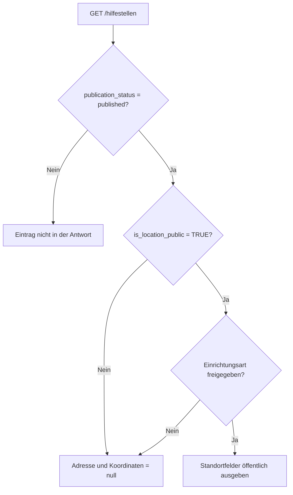

# Datenschutz: öffentliche Standorte und Standortfreigaben

**Stand: 24. November 2026 · Implementiert, mit fiktiven Datensätzen geprüft und produktiv im Portal bestätigt.**

## Ausgangslage und Schutzziel

Die öffentliche API `GET /hilfestellen` benötigt **keine Anmeldung**. Der Veröffentlichungsstatus einer Hilfestelle und die öffentliche Sichtbarkeit ihres genauen Standorts sind deshalb **zwei getrennte Entscheidungen**. Ein veröffentlichter Eintrag kann angezeigt werden, während seine Adresse und Koordinaten vertraulich bleiben.

Die Schutzlogik wirkt **serverseitig in FastAPI/PostgreSQL**, nicht ausschließlich durch ausgeblendete HTML-Schaltflächen:

1. Es werden nur Einträge mit `publication_status = 'published'` zurückgegeben.
2. Nur bei `is_location_public IS TRUE` **und** einem zugelassenen `facility_type` werden `address`, `latitude` und `longitude` übertragen.
3. Ist mindestens eine Bedingung nicht erfüllt, liefert die API für diese drei Felder **`null`**.
4. Die eigenständige Administratorfreigabe wird auf der Seite `/portal/standorte` verwaltet.



## Datenbankstand

| Objekt | Rolle |
|---|---|
| `hilfestelle.publication_status` | Veröffentlichung der Einrichtung (`draft`, `pending_review`, `published`) |
| `hilfestelle.is_location_public` | Separate Standortfreigabe, standardmäßig `FALSE` |
| `portal_public_location_type` | Positivliste zulässiger Einrichtungsarten (`facility_type` als Schlüssel) |
| `yana_reset_location_approval()` | PostgreSQL-Triggerfunktion zum automatischen Entzug alter Standortfreigaben |
| `trg_yana_reset_location_approval` | Trigger bei Änderung von Art, Adresse oder Koordinaten |

Im geprüften Projektstand enthält die Positivliste **nur `Beratungsstelle`**. `Schutzunterkunft` und der fiktive sonstige Testtyp sind nicht freigegeben. **Die Positivliste allein ist keine fachliche Prüfung:** Eine falsch als Beratungsstelle klassifizierte Einrichtung könnte sonst gefährdet sein. Vor jeder Freigabe muss daher ein Administrator die konkrete Einrichtung und die Veröffentlichungserlaubnis überprüfen.

Der Trigger setzt `is_location_public = FALSE`, sobald `facility_type`, `address`, `latitude` oder `longitude` tatsächlich geändert werden (`IS DISTINCT FROM`). Eine früher erteilte Freigabe gilt somit nicht automatisch für geänderte Standortdaten.

!!! warning "Bestandsdaten und Migrationen"
    Die genannten Felder, Tabelle und Trigger wurden im Projekt bereits eingerichtet. **Die SQL-Migrationen nicht erneut blind auf der produktiven Datenbank ausführen.** Vor Änderungen Schema, Berechtigungen und Backups kontrollieren.

## Öffentliche JSON-Antwort

Die Antwortform bleibt erhalten: Für nicht freigegebene Standorte haben die Felder **`address`, `latitude` und `longitude` den Wert `null`**. Andere bereits veröffentlichte Felder, etwa Name, Telefon, E-Mail oder `capacity`, bleiben nach bisherigem API-Vertrag grundsätzlich sichtbar.

```json
{
  "facility_id": 123,
  "name": "YANA Test-Beratungsstelle",
  "facility_type": "Beratungsstelle",
  "address": null,
  "latitude": null,
  "longitude": null
}
```

*Dieses JSON ist ein vereinfachtes Beispieldokument und kein vollständiger Live-Datensatz.*

## Administrationsoberfläche

Das Modul `portal_locations.py` stellt die geschützte Seite `/portal/standorte` bereit. Sie zeigt eine **kompakte, durchsuch- und filterbare Tabelle**; die Detailansicht klappt je Datensatz auf. Die Formulare verwenden CSRF-Tokens und die bestehenden Administratorberechtigungen.

| Methode | Route | Zweck |
|---|---|---|
| `GET` | `/portal/standorte` | Gesamtübersicht für Administratoren |
| `POST` | `/portal/standorte/{facility_id}/freigeben` | Standort nach Prüfung freigeben |
| `POST` | `/portal/standorte/{facility_id}/sperren` | Standortfreigabe zurücknehmen |

Die Freigaberoute prüft erneut serverseitig, ob die Einrichtung veröffentlicht, ihre Art erlaubt und Standortdaten vorhanden sind. Die Sperrroute setzt die Freigabe zurück. Partner dürfen diese Administratorfunktionen nicht aufrufen.

## Verifizierte Tests

- Öffentliche API mit Datenbank-Freigaben abgeglichen: geschützte Standorte bleiben `null`.
- Schutzunterkunft über einen direkten Freigabe-POST getestet: **HTTP 409** und keine Freigabe.
- Trigger mit absichtlicher Standortänderung innerhalb einer `ROLLBACK`-Transaktion geprüft.
- Fiktive Beratungsstelle: **freigeben → öffentliche Adresse sichtbar → sperren → Adresse wieder `null`**; alle Teständerungen zurückgerollt.
- Nach Bereitstellung wurde die Standortverwaltung auf dem produktiven Portal als funktionierend bestätigt.

Die Tests wurden mit fiktiven Datensätzen ausgeführt. Sie ersetzen keine unabhängige Sicherheitsprüfung.

## Grenzen vor einem Realbetrieb

- Der Filter schützt nur **drei Standortfelder**. Auch Name, E-Mail, Telefonnummer, Kapazität und Öffnungszeiten können bei Schutzunterkünften Rückschlüsse zulassen.
- Die Einrichtungsart muss fachlich korrekt klassifiziert und die Einwilligung bzw. Veröffentlichungsberechtigung geprüft werden.
- Schutzunterkunftsadressen dürfen nicht ungeprüft an **externe Geocoding-Dienste** geschickt werden.
- Die Flutter-App muss `null`-Koordinaten behandeln (kein fehlerhafter Marker oder Navigationslink). Ein vollständiger Gerätetest ist bislang nicht dokumentiert.
- Test- und Produktivcode nutzen noch dieselbe `app_db`; eine separate Staging-Datenbank ist offen.

Siehe [Geocoding](geocoding.md), [Portal-Tests](teamportal-tests.md), [Sicherheit](betrieb-sicherheit.md) und [Bedienungsanleitung](../nutzung/standortfreigaben.md).
