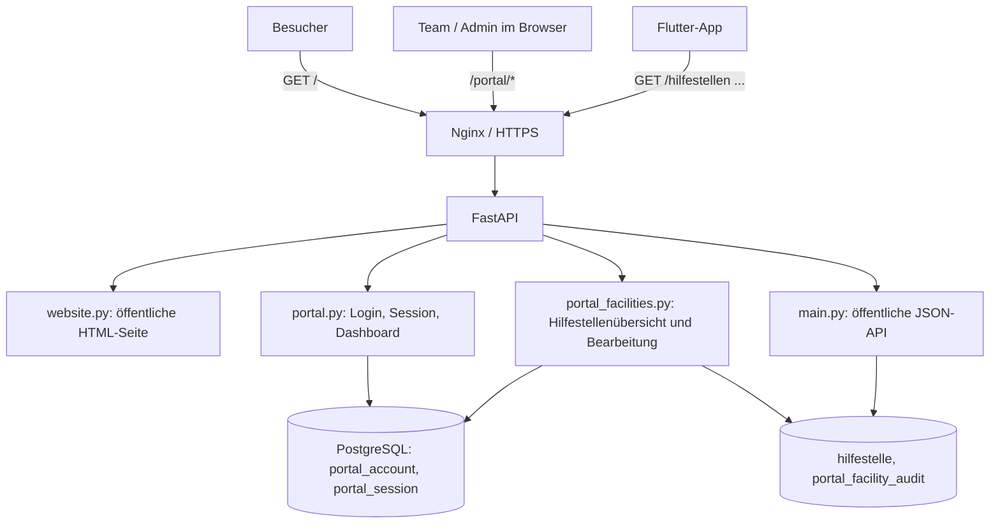

# Teamportal: Zweck, Rollen und Systemarchitektur

**Dokumentationsstand: 17. November 2026 · Status: Login, Dashboard, Hilfestellenübersicht und Bearbeitung produktiv getestet**

## 1. Fachliches Ziel

Das YANA-Teamportal ist ein geschützter Verwaltungsbereich der öffentlichen Website. Es erlaubt dem Entwicklungsteam, vorhandene Hilfestellen einzusehen und Kontaktdaten zu ändern. Dadurch sollen Datenbankeinträge perspektivisch ohne pgAdmin gepflegt werden können. Später sollen sich auch befugte Mitarbeitende von Hilfestellen, Kanzleien und anderen Organisationen anmelden und **nur ihre eigenen** Daten bearbeiten dürfen.

Die externe Selbstverwaltung ist noch nicht umgesetzt. Derzeit richtet sich die getestete Hilfestellenverwaltung an **`admin`** und **`team`**. Ein `facility`-Account wird für diese Verwaltung ausdrücklich abgewiesen.

## 2. Rollenmodell

| Rolle | Aktueller Funktionsumfang | Später vorgesehen |
|---|---|---|
| `admin` | Login, Dashboard, alle angezeigten Hilfestellen lesen/bearbeiten | Accounts und Organisationszuordnungen verwalten |
| `team` | Login, Dashboard, alle angezeigten Hilfestellen lesen/bearbeiten | Inhaltliche Freigabe und Qualitätssicherung |
| `facility` | Account-/Login-Struktur vorgesehen; allgemeine Hilfestellenverwaltung mit HTTP 403 gesperrt | Ausschließlich zugewiesene Einrichtung bearbeiten |
| Ohne Login | Öffentliche Website und öffentliche GET-API; **kein** Verwaltungszugriff | – |

Die Rollen werden **im Backend** geprüft. Allein das Ausblenden eines Links in HTML ist kein Zugriffsschutz. Eine gesonderte Tabelle zur Zuordnung externer Accounts zu Einrichtungen und ein Freigabeprozess fehlen derzeit.

## 3. Systemaufbau



**Technische Bausteine:** Ubuntu 24.04 LTS, Nginx, FastAPI, Jinja2, `psycopg` 3, PostgreSQL 16, systemd-Dienst `yana-api`. Die bestehende `.env` enthält den Datenbankzugang und den geheimen Session-Schlüssel. Bei einem Login werden Cookies nur über HTTPS übertragen.

## 4. Dateien und Zuständigkeit

```text
services/api/
├── main.py                      # FastAPI-App, CORS, Middleware und Router
├── database.py                  # PostgreSQL-Verbindung (get_connection)
├── website.py                   # öffentliche Startseite
├── portal.py                    # Login, Sessions, Dashboard, Logout
├── portal_facilities.py         # Übersicht, Formular, UPDATE und Audit
├── templates/
│   ├── base.html
│   ├── index.html
│   └── portal/
│       ├── login.html
│       ├── dashboard.html
│       ├── hilfestellen.html
│       └── hilfestellen_bearbeiten.html
└── static/
    └── css/
        └── style.css
```

**Wichtig:** Die tatsächliche Bearbeitungs-Template-Datei heißt **`hilfestellen_bearbeiten.html`** (Plural). Auch in `portal_facilities.py` muss `name="portal/hilfestellen_bearbeiten.html"` stehen. Ein früherer abweichender Verweis hat im Test zu `TemplateNotFound` geführt und wurde korrigiert.

## 5. Implementierte Browser-Routen

| Methode | Pfad | Funktion | Schutz |
|---|---|---|---|
| `GET` | `/` | Öffentliche Landingpage | Ohne Login |
| `GET` | `/portal/login` | Login-Formular mit CSRF-Token | Ohne Login |
| `POST` | `/portal/login` | Passwort prüfen, Session anlegen | CSRF + Rate-Limit/Account-Sperre |
| `GET` | `/portal/dashboard` | Geschütztes Dashboard | Gültige Session |
| `POST` | `/portal/logout` | Session löschen | Session + CSRF-Prüfung |
| `GET` | `/portal/hilfestellen` | Übersicht vorhandener Einträge | Rolle `admin`/`team` |
| `GET` | `/portal/hilfestellen/{facility_id}/edit` | Bearbeitungsformular | Rolle `admin`/`team` |
| `POST` | `/portal/hilfestellen/{facility_id}/edit` | Validieren, UPDATE, Audit | Rolle `admin`/`team` + CSRF |

Die Portal-Routen sind nicht die Flutter-JSON-API. Sie liefern HTML und sind im FastAPI-Router aus der Swagger-Dokumentation ausgeblendet (`include_in_schema=False`). Das Ausblenden ist **keine** Zugriffskontrolle.

## 6. Ablauf eines Datensatzupdates

```mermaid
sequenceDiagram
    participant B as Browser (Team/Admin)
    participant P as FastAPI-Portal
    participant DB as PostgreSQL
    B->>P: GET /portal/hilfestellen/{id}/edit + Session-Cookie
    P->>DB: Session und Rolle prüfen; Hilfestelle laden
    DB-->>P: Berechtigte Daten
    P-->>B: Formular + CSRF-Token
    B->>P: POST Formular + Cookie + CSRF-Token
    P->>DB: Validierung, SELECT ... FOR UPDATE
    P->>DB: UPDATE hilfestelle + INSERT portal_facility_audit
    DB-->>P: Commit
    P-->>B: HTTP 303 → Formular?saved=1
```

Nur vier Kontaktfelder werden momentan verändert. Die **Neuaufnahme von Hilfestellen** (`INSERT`) ist unser nächster geplanter Entwicklungsschritt; sie existiert noch nicht. Siehe [Weiterarbeit](weiterarbeit.md) und [Hilfestellenpflege](teamportal-hilfestellen.md).
