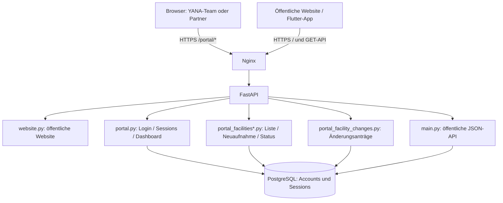
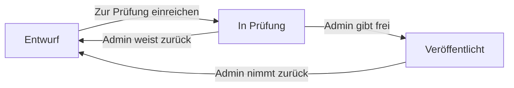
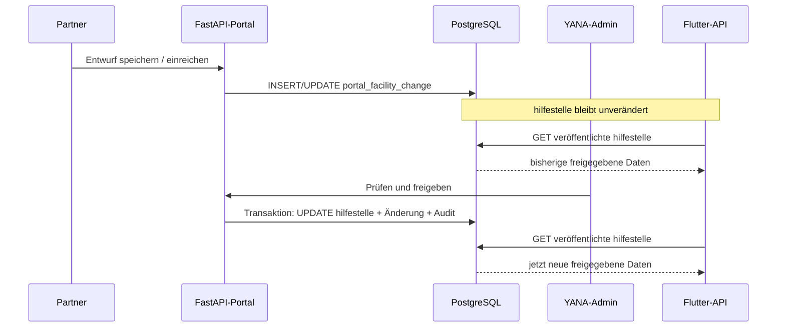

# Verwaltungsportal: Architektur, Rollen und Datenflüsse

**Stand: 18. November 2026 · Gemeinsames Portal für Administratoren und zugeordnete Partner produktiv getestet**

## 1. Ziel und Grundprinzip

YANA verwendet **ein Verwaltungsportal** unter `/portal/*` mit gemeinsamer Anmeldung, Dashboard, Hilfestellenübersicht und einheitlichem Design. Die Darstellung und die zulässigen Aktionen richten sich nach der in PostgreSQL hinterlegten Rolle. Externe Hilfestellen und Kanzleien erhalten keine separate Website.

## 2. Rollen- und Berechtigungsmodell

| Bereich / Aktion | `admin` (YANA-Team) | `partner` (externe Organisation) |
|---|---|---|
| Portal-Login und Dashboard | Ja | Ja |
| Hilfestellenübersicht | Alle Einträge | Nur zugewiesene Einträge |
| Entwurf einer Hilfestelle ändern | Ja | Nur eigener zugewiesener Entwurf |
| Neue Hilfestelle erstellen | Ja (aktuell nur Testdaten) | Nein |
| Entwurf zur Prüfung einreichen | Ja | Nur zugewiesener Entwurf |
| Veröffentlichung / Zurückweisung / Zurücknahme | Ja | Nein |
| Änderung an veröffentlichtem Eintrag vorschlagen | Ja | Nur zugewiesener Eintrag |
| Eingereichten Änderungsvorschlag freigeben / ablehnen | Ja | Nein |
| Accounts verwalten und Hilfestellen zuweisen | Bisher über pgAdmin | Nein |

Die frühere Rolle `team` wird im neuen Berechtigungsmodell **nicht mehr verwendet**. `facility` ist keine aktuelle operative Rolle. Das YANA-Team ist organisatorisch die Rolle `admin`; externe Organisationen heißen **YANA-Partner** (`partner`).

## 3. Systemarchitektur



Es werden dieselben bestehenden technischen Bausteine verwendet: Ubuntu, Nginx/HTTPS, FastAPI, Jinja2, Psycopg 3, PostgreSQL und der systemd-Dienst `yana-api`.

## 4. Relevante Dateien

```text
services/api/
├── main.py                       # FastAPI, Middleware, öffentliche GET-API, Router
├── database.py                   # get_connection() / PostgreSQL
├── website.py                    # Öffentliche Informationswebsite
├── portal.py                     # Login, Session, Dashboard, Logout
├── portal_access.py              # require_account / require_admin / Partnerprüfung
├── portal_facilities.py          # Rollenabhängige Liste und Bearbeitung von Entwürfen
├── portal_facilities_create.py   # Neue Test-Hilfestelle anlegen
├── portal_facilities_status.py   # Einreichen / Veröffentlichen / Zurückweisen
├── portal_facility_changes.py    # Separate Änderungsvorschläge und Admin-Prüfung
├── templates/portal/
│   ├── login.html
│   ├── dashboard.html
│   ├── hilfestellen.html
│   ├── hilfestellen_neu.html
│   ├── hilfestellen_bearbeiten.html
│   ├── aenderung_bearbeiten.html
│   └── aenderungen_pruefen.html
└── static/css/style.css
```

Die Datei `hilfestellen_bearbeiten.html` besitzt bewusst **Plural** im Namen. Die Test- und Produktivkopien des Codes befinden sich auf dem VPS an unterschiedlichen Orten, nutzen aber derzeit dieselbe PostgreSQL-Datenbank.

## 5. Rechteprüfung: HTML und Backend

Das Portal blendet für Partner nicht erlaubte Optionen aus. Zusätzlich prüft das Backend Rolle und Einrichtungszuordnung. Für fremde IDs wird auch beim direkten Aufruf von `GET`/`POST` der Zugriff verhindert. Hierzu wird die Tabelle `portal_facility_assignment` in SQL-Abfragen einbezogen. Der Verwaltungsrouter verwendet HTTP-Sessions; CSRF-Token schützen zustandsändernde Formulare.

Der alte Dashboardfehler **„Keine Berechtigung“** bei Partneranmeldung entstand durch einen noch auf `admin`/`team` begrenzten Link in `templates/portal/dashboard.html`. Die Bedingung wurde auf `admin`/`partner` aktualisiert; der Partnerzugang funktioniert seither.

## 6. Zwei getrennte fachliche Abläufe

### Neuaufnahme und Veröffentlichungsstatus



Der Status steht in `hilfestelle.publication_status`. Die öffentliche API `/hilfestellen` liefert **nur `published`**.

### Änderung eines bereits veröffentlichten Eintrags



Vor der Freigabe werden die ursprünglichen veröffentlichten Werte nochmals mit der gespeicherten Basis verglichen, um veraltete Anträge nicht stillschweigend zu übernehmen.

## 7. Grenzen

Eine Benutzerverwaltungsseite existiert noch nicht; Testpartner und Zuordnung wurden in PostgreSQL eingerichtet. Für echte Schutzstandorte reicht der Einrichtungsstatus nicht, denn veröffentlichte Adressen und Koordinaten werden durch die JSON-API aktuell ausgegeben. Mehr: [Sicherheit](betrieb-sicherheit.md) und [Änderungsfreigabe](teamportal-aenderungsfreigabe.md).
