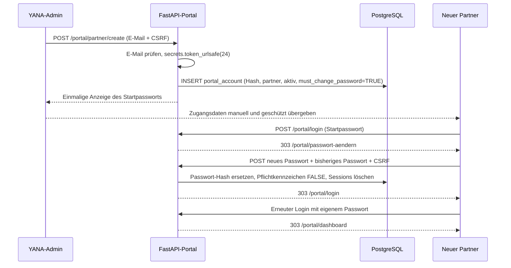

# Partner- und Benutzerverwaltung im YANA-Portal

**Stand: 23. November 2026 · Implementiert, mit Test-Accounts geprüft und nach Projektverlauf produktiv bereitgestellt.**

## 1. Ziel und Abgrenzung

Das bereits vorhandene Verwaltungsportal wurde um eine **Administratoroberfläche für externe Partner-Accounts** erweitert. Ein separates Partnerportal oder eine öffentliche Registrierung sind nicht erforderlich. Das YANA-Team verwaltet Partner unter **`/portal/partner`**; die Rollen sind weiterhin ausschließlich `admin` und `partner`.

Das Verfahren wurde bewusst für ein Schulprojekt ohne Mailserver vereinfacht: Ein Admin legt den Account anhand einer E-Mail-Adresse an. Python generiert ein kryptografisch zufälliges **Startpasswort**, das nur in der unmittelbaren HTML-Antwort angezeigt wird. Die Weitergabe geschieht manuell außerhalb von YANA. Ein neuer Partner muss das Passwort beim ersten Login ändern, bevor er seine Einrichtungen verwalten kann.

**Kein Funktionsumfang dieser Erweiterung:** öffentliche Registrierung, automatische E-Mail-Zustellung, Passwort-Vergessen-Selbstservice, Mehrfaktor-Authentifizierung, Organisationstabelle oder Rollenvergabe durch Partner.

## 2. Funktionen und Berechtigungen

| Funktion | Administrator (`admin`) | Partner (`partner`) |
|---|---|---|
| Partnerliste öffnen | Ja | Nein (`403`) |
| Partner-Account erstellen | Ja | Nein (`403`) |
| Einrichtung zuweisen / Zuordnung entfernen | Ja | Nein (`403`) |
| Aktiven Partner deaktivieren | Ja | Nein (`403`) |
| Deaktivierten Partner reaktivieren | Ja | Nein (`403`) |
| Partnerpasswort zurücksetzen | Ja, für aktive Partner | Nein (`403`) |
| Eigenes Passwort ändern | Ja | Ja |
| Eigene zugewiesene Hilfestellen bearbeiten | Alle Einträge | Nur explizit zugewiesene |

Der **Server prüft Rolle, aktive Sitzung und CSRF-Token**, nicht nur die Sichtbarkeit von Formularen. Bei Änderung des Passwortes werden Sessions des betroffenen Accounts entfernt; beim Deaktivieren und Zurücksetzen ebenso. `admin_account()` verhindert, dass Partner die Verwaltungsaktionen durch direkte POST-Aufrufe nutzen.

## 3. Abläufe

### Partner anlegen und zum ersten Mal anmelden



Während `must_change_password = TRUE` ist, blockiert die serverseitige Prüfung in `session_account()` die regulären geschützten Portalrouten mit `403`; Login, Passwortänderung und Logout bleiben zugänglich. Das verhindert die Nutzung der Hilfestellenverwaltung mit dem bloßen Startpasswort.

### Deaktivieren, reaktivieren und zurücksetzen

| Aktion | Datenbankänderung | Wirkung |
|---|---|---|
| **Deaktivieren** | `is_active = FALSE`; Sessions löschen | Login und bestehende Sitzung verlieren ihre Gültigkeit |
| **Reaktivieren** | `is_active = TRUE`; neuer Passwort-Hash; `must_change_password = TRUE` | Altes Passwort ungültig; neues Startpasswort einmalig anzeigen |
| **Passwort zurücksetzen** | Neuer Passwort-Hash; `must_change_password = TRUE`; Fehlversuche/Sperrzeit zurücksetzen; Sessions löschen | Bisheriges Passwort ungültig; nächster Login erfordert Passwortwechsel |
| **Eigenes Passwort ändern** | Passwort-Hash ersetzen; `must_change_password = FALSE`; Sessions löschen | Neuer Login mit selbst gewähltem Passwort erforderlich |

**Zuordnungen in `portal_facility_assignment` bleiben beim Deaktivieren und Reaktivieren bestehen.** Für deaktivierte Accounts sind die Zuweisungs-/Entfernungsformulare in der Verwaltung ausgeblendet und die betroffenen Routen akzeptieren nur aktive Partner.

## 4. Implementierte Dateien

| Pfad unter `services/api/` | Aufgabe |
|---|---|
| `portal_partners.py` | Partnerliste, Account-Erstellung, Zuweisung/Entfernung, Aktivstatus, Admin-Reset |
| `portal_password.py` | GET/POST für eigenen Passwortwechsel einschließlich Prüfung des bisherigen Passworts |
| `portal.py` | Login, `session_account`, Pflichtwechsel-Sperre, CSRF, Session- und Passwort-Hasher |
| `main.py` | Einbindung von `partners_router` und `password_router` |
| `templates/portal/partner.html` | Partnerliste, Account- und Zuordnungsformulare mit CSRF |
| `templates/portal/partner_erstellt.html` | Einmalige Startpasswortanzeige für Erstellung, Reaktivierung und Reset |
| `templates/portal/passwort_aendern.html` | Formular für Pflichtwechsel und freiwilligen Wechsel |
| `templates/portal/dashboard.html` | Administrator-Kachel und Link für eigene Passwortänderung |
| `static/css/style.css` | Gestaltung der Verwaltungsformulare und Passwortanzeige |

`portal_partners.py` verwendet unter anderem `secrets.token_urlsafe(24)` und `password_hash.hash()`; es wird **nur der Argon2-basierte Passwort-Hash** gespeichert. Beim Zurücksetzen/bei der Reaktivierung wird ein neues Startpasswort erzeugt, nicht das bisherige rekonstruiert.

## 5. HTTP-Routen

| Methode | Route | Bedeutung / Zugriff |
|---|---|---|
| `GET` | `/portal/partner` | Admin: Partnerliste und Verwaltung |
| `POST` | `/portal/partner/create` | Admin: Partner erstellen, Passwort einmalig anzeigen |
| `POST` | `/portal/partner/{account_id}/assign` | Admin: Einrichtung zuweisen |
| `POST` | `/portal/partner/{account_id}/unassign` | Admin: Zuordnung entfernen |
| `POST` | `/portal/partner/{account_id}/deactivate` | Admin: aktiven Partner deaktivieren |
| `POST` | `/portal/partner/{account_id}/reactivate` | Admin: Partner aktivieren und Startpasswort neu setzen |
| `POST` | `/portal/partner/{account_id}/reset-password` | Admin: Passwort eines aktiven Partners zurücksetzen |
| `GET` / `POST` | `/portal/passwort-aendern` | Angemeldeter Account: eigenes Passwort ändern |

Ein erfolgreicher Statuswechsel oder eine Zuweisungsänderung leitet mit HTTP `303` zurück zur Partnerliste. Das Erstellen, Reaktivieren und Zurücksetzen liefern stattdessen HTTP `200` mit der **nicht erneut abrufbaren** Startpasswortanzeige. Für nicht angemeldete POST-Aufrufe wurde `401`, für Partner bei Admin-Aktionen `403` geprüft.

## 6. Datenbankschema und Berechtigungen

Die Tabelle `public.portal_account` wurde um diese Spalte erweitert:

```sql
ALTER TABLE public.portal_account
ADD COLUMN IF NOT EXISTS must_change_password BOOLEAN NOT NULL DEFAULT FALSE;
```

Alte Konten behalten damit zunächst `FALSE`. Neue Partner werden mit `role='partner'`, `is_active=TRUE` und `must_change_password=TRUE` angelegt. E-Mail-Adressen werden vor dem INSERT normalisiert; ein eindeutiger Index auf `LOWER(email)` wurde im Projekt eingerichtet. Vor dem Anlegen eines solchen Index müssen eventuell vorhandene Duplikate bereinigt werden.

Dem **Anwendungsbenutzer** `app_user` wurden bedarfsgerechte Spalten- und Tabellenrechte für Account-INSERT/UPDATE, Session-DELETE sowie SELECT/INSERT/DELETE auf Partnerzuordnungen eingeräumt. Ein Admin des *Webportals* ist dabei nicht mit einem PostgreSQL-Superuser gleichzusetzen. Schema und reale Grants sind beim erneuten Aufbau gesondert zu prüfen, nicht blind neu anzuwenden.

```sql
-- Lesende Diagnose ohne Passwort-Hashes
SELECT account_id, role, is_active, must_change_password
FROM public.portal_account
ORDER BY account_id;
```

Keine realen E-Mail-Adressen, Passwort-Hashes, Startpasswörter oder Session-Tokens in die Projektdokumentation aufnehmen.

## 7. Sicherheit und bewusste Vereinfachungen

- Startpasswörter werden mit `secrets` erzeugt; **keine** festen Default-Passwörter und keine Klartextspeicherung in PostgreSQL.
- Ein Startpasswort erscheint nur in der unmittelbar ausgegebenen HTML-Antwort. Die Antwort setzt `Cache-Control: no-store, private` und weitere Schutzheader. Ein Browser, Screenshot oder eine unsichere manuelle Übertragung können dennoch Kopien erzeugen.
- Die Passwortänderung verlangt das bisherige Passwort, einen neuen Wert mit **14 bis 128 Zeichen** und identische Wiederholung. Dass sich beide Passwörter unterscheiden, wird geprüft.
- Session-Cookies werden signiert und per HTTPS verwendet; serverseitig wird die Session mit `portal_session` abgeglichen. Aktive Sitzungen werden bei Passwortänderung, Reset und Deaktivierung gelöscht.
- Die Administratorrolle wird serverseitig geprüft. Account-POSTs enthalten CSRF-Token.
- Kein Mailserver und kein Wiederherstellungslink: Vergisst ein Partner das Passwort, stellt **nur ein Administrator** ein neues Startpasswort aus und übergibt es manuell. Dieses Verfahren ist für den Projektprototyp vorgesehen, **nicht** als vollständig geprüfte Lösung für echten sensiblen Beratungsbetrieb.
- Für echte Partner sind sicherer Ausgabekanal, Nachweis der Empfängeridentität, administrative Auditierung, MFA, Datenschutz und Backup-/Recovery-Konzept zusätzliche Anforderungen.

## 8. Tests und Nachweise vom 23.11.2026

Folgende Prüfungen wurden im Projektverlauf als erfolgreich gemeldet:

1. **Partnerzuordnung:** Admin- und Partnerlogin; Rollenprüfung (`200`/`403`); Zuweisung und Entfernung einer fiktiven Hilfestelle; anschließende Bereinigung.
2. **Account-Erstellung:** Schreibfreie Routentests; anschließend Ende-zu-Ende-Test mit neu angelegtem Testpartner, Passwort-Hash, Pflichtwechsel, erneuter Anmeldung und gesperrtem Adminzugriff (**sieben Prüfungen**).
3. **Account-Lebenszyklus:** Schreibfreie Prüfung der drei zusätzlichen Admin-Endpunkte (**sechs Prüfungen**); anschließend Testpartner erstellt, deaktiviert, reaktiviert, Passwort gewechselt, zurückgesetzt, alte Session geprüft und erneut eingeloggt (**zwölf Prüfungen**).
4. **Bereitstellung:** Nach Bereinigung der temporären Testaccounts wurden die getesteten Dateien in das produktive Backend übernommen und die Funktionen nach Nutzerangabe erfolgreich geprüft.

Temporäre Tests wurden auf dem VPS beispielsweise als `partner_permissions_test_local.py`, `partner_assignment_test_local.py`, `partner_create_e2e_local.py` und `partner_lifecycle_test_local.py` ausgeführt; sie sind **keine zwingenden Produktivmodule**. Weitere Details: [Portal-Tests](teamportal-tests.md).

!!! warning "Gemeinsame Datenbank"
    Der Testcode unter `~/yana-portal-test` und das produktive Backend unter `~/yana-backend` nutzen **dieselbe Datenbank `app_db`**. Schreibende Integrationstests können deshalb auch produktive Daten verändern. Ausschließlich eindeutig gekennzeichnete fiktive Accounts verwenden, vor Tests Zustand und Backup prüfen und die Datensätze kontrolliert bereinigen.

## 9. Grenzen und nächste Verbesserungen

Die neue Verwaltung löst die manuelle Account-Anlage in pgAdmin für den normalen Schulprojektbetrieb ab. Weiterhin offen sind insbesondere eine getrennte Staging-Datenbank, ein nachvollziehbares **Account-Audit** für Erstellen/Sperren/Reset, eine geprüfte Identitätskontrolle bei Passwortübergabe, MFA, automatisierte Regressionstests und ein sauberer Datenschutzprozess für echte Einrichtungen. Das vorhandene `portal_facility_audit` dokumentiert **Hilfestellenaktionen**, nicht automatisch sämtliche Änderungen an Benutzerkonten.

Siehe [Nutzungsanleitung für Partnerkonten](../nutzung/partnerverwaltung.md), [Login und Sessions](teamportal-login.md), [Portal-Datenbank](teamportal-datenbank.md) und [Betrieb und Sicherheit](betrieb-sicherheit.md).
