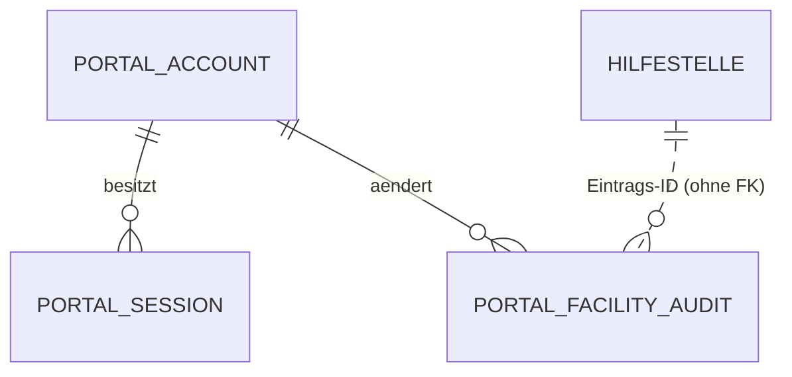

# PostgreSQL: Benutzer, Sessions und Änderungsprotokoll

**Dokumentationsstand: 17. November 2026 · Die Tabellen wurden im Projekt angelegt und getestet.**

## 1. Erweiterung des ursprünglichen ER-Modells

Das ursprüngliche [ER-Modell](datenmodell.md) besitzt acht Fach-/Chat-Tabellen. Für das Teamportal wurden **drei zusätzliche Tabellen** ergänzt. Die bestehenden acht Tabellen und ihre Geschäftslogik bleiben erhalten.

| Tabelle | Zweck | Bezüge |
|---|---|---|
| `portal_account` | Portal-Login, Argon2-Hash, Rolle, Sperrstatus | Primärschlüssel `account_id` |
| `portal_session` | Aktive Login-Sessions mit Ablauf | `account_id → portal_account` |
| `portal_facility_audit` | Protokoll von Änderungen an Hilfestellen | `account_id → portal_account`; `facility_id` als referenzierte Fach-ID ohne FK |



Die letzten beiden Audit-JSON-Felder enthalten Kontaktinformationen; deshalb sind Protokollzugriff, Sicherung, Aufbewahrung und Löschung datenschutzrechtlich zu regeln.

## 2. Angewendete Tabellendefinitionen

Die folgenden SQL-Abschnitte dokumentieren die bislang im Projekt verwendeten Definitionen. Sie sind **kein automatisches Migrationssystem**. Vor Anwendung auf einer anderen DB Tabellen-/Rollenbestand und Schema abgleichen.

### `portal_account`

```sql
CREATE TABLE IF NOT EXISTS public.portal_account (
    account_id BIGSERIAL PRIMARY KEY,
    email VARCHAR(254) NOT NULL UNIQUE,
    password_hash TEXT NOT NULL,
    role VARCHAR(20) NOT NULL DEFAULT 'team'
        CHECK (role IN ('admin', 'team', 'facility')),
    is_active BOOLEAN NOT NULL DEFAULT TRUE,
    failed_attempts INTEGER NOT NULL DEFAULT 0,
    locked_until TIMESTAMPTZ,
    created_at TIMESTAMPTZ NOT NULL DEFAULT CURRENT_TIMESTAMP,
    CONSTRAINT email_lowercase CHECK (email = LOWER(email))
);
```

`password_hash` enthält **nur einen Argon2-Hash**, kein Klartextpasswort. Für die Einrichtung wurde ein lokales Passwort-Hashing-Skript mit `pwdlib[argon2]` und `getpass()` verwendet. Anschließend wurde der Hash in pgAdmin für den ersten aktiven `admin`-Account eingefügt. Der tatsächliche Account und sein Hash werden **nicht** in dieser Dokumentation gespeichert.

### `portal_session`

```sql
CREATE TABLE IF NOT EXISTS public.portal_session (
    session_hash CHAR(64) PRIMARY KEY,
    account_id BIGINT NOT NULL
        REFERENCES public.portal_account(account_id) ON DELETE CASCADE,
    created_at TIMESTAMPTZ NOT NULL DEFAULT CURRENT_TIMESTAMP,
    expires_at TIMESTAMPTZ NOT NULL
);
CREATE INDEX IF NOT EXISTS idx_portal_session_account
    ON public.portal_session(account_id);
```

Die Anwendung legt eine zufällige Session-ID an; in PostgreSQL steht nur ihr SHA-256-Hash. Bei jedem geschützten Aufruf werden Ablaufzeit und `is_active` geprüft. Der Logout löscht die Session. Cookie und Datenbank-Session laufen nach der derzeitigen Konfiguration nach etwa **30 Minuten** ab.

### `portal_facility_audit`

```sql
CREATE TABLE IF NOT EXISTS public.portal_facility_audit (
    audit_id BIGSERIAL PRIMARY KEY,
    facility_id BIGINT NOT NULL,
    account_id BIGINT NOT NULL REFERENCES public.portal_account(account_id),
    changed_at TIMESTAMPTZ NOT NULL DEFAULT CURRENT_TIMESTAMP,
    before_data JSONB NOT NULL,
    after_data JSONB NOT NULL
);
```

Beim erfolgreichen Speichern einer echten Änderung werden `before_data` und `after_data` **in derselben Transaktion** wie der `UPDATE` geschrieben. Speichern ohne Datenänderung erzeugt nach der implementierten Logik keinen neuen Audit-Eintrag. Die Audit-Tabelle besitzt bislang **keinen** Fremdschlüssel von `facility_id` auf `hilfestelle`; das ist für spätere Lösch- und Historienkonzepte zu beachten.

## 3. Datenbankberechtigungen

Für die Entwicklung wurden folgende abgestufte Berechtigungen für die vorhandene Rolle `app_user` eingesetzt (in der Ziel-Datenbank ausführen, wenn noch nicht vorhanden):

```sql
GRANT SELECT, UPDATE ON public.portal_account TO app_user;
GRANT SELECT, INSERT, DELETE ON public.portal_session TO app_user;
GRANT SELECT, INSERT ON public.portal_facility_audit TO app_user;
GRANT USAGE, SELECT ON SEQUENCE public.portal_facility_audit_audit_id_seq TO app_user;
GRANT SELECT ON public.hilfestelle TO app_user;
GRANT UPDATE (name, phone, email, opening_hours)
    ON public.hilfestelle TO app_user;
```

Die bisherige Rolle `app_user` besitzt bereits weitergehende Rechte an `app_db` (in der ursprünglichen Installation sogar Eigentümerrechte). Diese `GRANT`-Befehle **begrenzen bestehende Privilegien nicht automatisch**. Eine striktere Trennung zwischen Migrations-/Adminrolle, lesender öffentlicher API und schreibender Portalrolle ist vor Betrieb mit echten Daten vorgesehen.

## 4. Diagnoseabfragen (ohne Geheimnisse)

```sql
-- Existieren die Tabellen?
SELECT to_regclass('public.portal_account'),
       to_regclass('public.portal_session'),
       to_regclass('public.portal_facility_audit');

-- Nur Metadaten des Administrator-Accounts, NICHT den Hash anzeigen
SELECT account_id, role, is_active FROM public.portal_account;

-- Letzte Änderungsprotokolle ohne gespeicherte Kontaktwerte
SELECT audit_id, facility_id, account_id, changed_at
FROM public.portal_facility_audit
ORDER BY changed_at DESC LIMIT 10;
```

Beachte: Ein erfolgreich getestetes Login beweist, dass die notwendigen Rechte für diesen Anmeldepfad praktisch vorhanden waren; es dokumentiert nicht automatisch ein umfassendes Least-Privilege-Konzept.

## 5. Noch ausstehende Datenmodellschritte

- Zuordnung `portal_account ↔ hilfestelle` für externe `facility`-Accounts.
- Freigabeprozess vor öffentlicher Veröffentlichung geänderter Daten.
- Tabellenerweiterungen für öffentliche Sichtbarkeit, Veröffentlichungsstatus und Schutzstandorte.
- Schema-Migrationen im Repository statt ausschließlich manueller SQL-Eingaben in pgAdmin.
- Aufbewahrungsfristen, Protokollzugriff und Datenschutzprüfung für Audit-Einträge.

Weitere Details: [Anmeldung](teamportal-login.md), [Hilfestellenbearbeitung](teamportal-hilfestellen.md) und [Sicherheit](betrieb-sicherheit.md).
