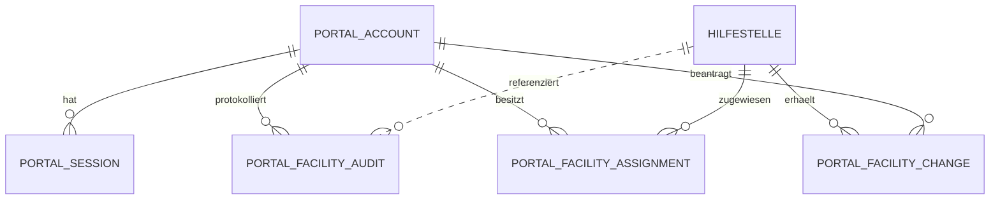

# PostgreSQL: Verwaltungsportal, Partnerzuordnung und Änderungsvorschläge

**Stand: 23. November 2026 · Partner-Accounts und Passwortwechsel ergänzt**

## 1. Überblick

Das ursprüngliche [ER-Modell](datenmodell.md) enthält acht Fach- und Chat-Tabellen. Für das Verwaltungsportal wurden zusätzlich fünf Tabellen eingerichtet. Bei vollständig vorhandenem Ursprungsschema sind damit **13 Tabellen** dokumentiert. Die ursprüngliche ER-Abbildung zeigt die Portal-Erweiterungen nicht.

| Tabelle | Aufgabe |
|---|---|
| `portal_account` | Account mit Argon2-Passwort-Hash, Rolle, Aktivstatus, Login-Sperre |
| `portal_session` | Serverseitig überprüfbare Login-Sessions, `session_hash` und Ablaufdatum |
| `portal_facility_audit` | Nachvollziehbare Erstellung, Bearbeitung, Statuswechsel und Antragsentscheidung |
| `portal_facility_assignment` | Explizite n:m-Zuordnung zwischen Partner-Accounts und Hilfestellen |
| `portal_facility_change` | Getrennte Änderungsvorschläge für bereits veröffentlichte Einträge |



## 2. Account und Sessions

**`portal_account`:** `account_id` (Primärschlüssel), `email` (normalisiert, eindeutiger Index auf `LOWER(email)`), `password_hash`, `role` (`admin` oder `partner`), `is_active`, `must_change_password` (Boolean, Standard `FALSE`), `failed_attempts`, `locked_until`, `created_at`. Partner werden mittlerweile durch die Administratoroberfläche angelegt; der Account erhält ein zufälliges Startpasswort als Hash und `must_change_password = TRUE`. Ein bestehender Administratoraccount muss dafür nicht geändert werden.

**`portal_session`:** `session_hash` ist der SHA-256-Hash des zufällig generierten Session-Tokens; `account_id` verweist auf den Account; `created_at` und `expires_at` speichern Gültigkeitszeiten. Der Test-/Produktivcode verwendet den gleichen Sessionmechanismus.

> Ältere SQL-Dokumentationsstände enthielten die Rollen `team`/`facility`. Das Rollenmodell wurde auf `admin`/`partner` migriert. **Nicht** das alte `CREATE TABLE` oder frühere `CHECK`-Constraints auf der aktuellen Datenbank erneut anwenden.

## 3. Einrichtungsstatus

Die ursprüngliche Tabelle `public.hilfestelle` erhielt:

```sql
publication_status VARCHAR(20) NOT NULL DEFAULT 'draft'
```

Die erlaubten Werte sind `draft`, `pending_review` und `published` (CHECK-Einschränkung). Die öffentliche JSON-API liest nur veröffentlichte Datensätze. Die beiden ursprünglichen fiktiven Einträge wurden für die Tests veröffentlicht; neu angelegte Einträge beginnen als Entwurf.

## 4. Partnerzuordnung (`portal_facility_assignment`)

| Spalte | Aufgabe |
|---|---|
| `account_id` | Fremdschlüssel auf `portal_account` |
| `facility_id` | Fremdschlüssel auf `hilfestelle` |
| `assigned_at` | Zeitpunkt der Zuweisung |

Die Kombination `(account_id, facility_id)` bildet den **zusammengesetzten Primärschlüssel**. Pro Partner sind mehrere Einrichtungen, pro Einrichtung mehrere berechtigte Accounts möglich. Ein zusätzlicher Index auf `facility_id` unterstützt Abfragen von der Einrichtungsseite.

Die tatsächliche Zuweisung wird in PostgreSQL abgefragt, nicht nur im HTML überprüft. Eine fehlende Partnerzuordnung führt beim Zugriff auf fremde Einrichtungen typischerweise zu HTTP 404.

## 5. Audit (`portal_facility_audit`)

| Spalte | Bedeutung |
|---|---|
| `audit_id` | Eindeutiger Audit-Datensatz |
| `facility_id` | Betroffene Hilfestelle (historisch ohne erzwungenen FK) |
| `account_id` | Ausführender Portal-Account |
| `changed_at` | Zeitpunkt |
| `event_type` | Art der Aktion, z. B. `created`, `updated`, `submitted`, `published`, `change_approved` |
| `before_data`, `after_data` | JSONB-Protokollwerte |

Status- und Änderungsfreigaben schreiben Audit-Ereignisse in derselben Transaktion wie die Datenänderung. Die Audit-Tabelle enthält möglicherweise Kontaktinformationen und ist nicht öffentlich.

## 6. Änderungsvorschläge (`portal_facility_change`)

Die Migration `sql/01_change_requests.sql` legt diese Tabelle neu an. Sie wurde im Projekt durchgeführt und darf auf der bestehenden Datenbank nicht unkontrolliert erneut ausgeführt werden.

| Spalte | Datentyp / Bedeutung |
|---|---|
| `change_id` | `BIGINT GENERATED ALWAYS AS IDENTITY`, Primärschlüssel |
| `facility_id` | FK auf Hilfestelle |
| `created_by_account_id` | FK auf Antragsteller |
| `status` | `draft`, `pending_review`, `approved`, `rejected`, `cancelled` |
| `base_data` | JSONB: bislang veröffentlichte Werte beim Antrag |
| `proposed_data` | JSONB: beantragte Werte |
| `review_note` | Optionale Prüfnotiz, bis 500 Zeichen |
| `reviewed_by_account_id` | Optionaler FK auf den prüfenden Administrator |
| `created_at`, `updated_at` | Erstellungs-/Änderungszeitpunkt |
| `submitted_at`, `reviewed_at` | Einreichungs-/Entscheidungszeitpunkt |

Die verwendete Status-Constraint und der partielle Unique-Index erlauben nur **einen gleichzeitig aktiven** Änderungsentwurf oder Prüfantrag pro Einrichtung:

```sql
CREATE UNIQUE INDEX portal_facility_change_one_open
ON public.portal_facility_change (facility_id)
WHERE status IN ('draft', 'pending_review');
```

Ein weiterer Index `portal_facility_change_review_queue` unterstützt die Bearbeitung offener Prüfungen. Die eigentlichen öffentlichen Spalten von `hilfestelle` werden **erst bei Admin-Freigabe** geändert. Ein veralteter Antrag wird beim Freigabeversuch abgewiesen.

## 7. Datenbankberechtigungen

Im Projekt wurde der bereits vorhandenen DB-Rolle `app_user` schrittweise Zugriff für diese Funktionen zugewiesen, u. a.:

```sql
GRANT SELECT ON public.portal_facility_assignment TO app_user;
GRANT SELECT, INSERT, UPDATE ON public.portal_facility_change TO app_user;
GRANT UPDATE (publication_status) ON public.hilfestelle TO app_user;
```

Für die Neuanlage wurden zusätzlich `INSERT` auf `hilfestelle` und geeignete Sequenzrechte eingerichtet. Vor einem Neuaufbau auf einer anderen Umgebung **tatsächliche PostgreSQL-GRANTs und Sequenztyp prüfen**; ältere und neue Identity-/Serial-Definitionen sind nicht zwangsläufig identisch. Bestehende globale Rechte von `app_user` müssen zusätzlich auditiert werden.

## 8. Sichere Diagnoseabfragen

```sql
-- Rollenübersicht ohne E-Mail- oder Passwortanzeige
SELECT role, COUNT(*) FROM public.portal_account GROUP BY role;

-- Einträge nach Veröffentlichungsstatus
SELECT facility_id, name, publication_status
FROM public.hilfestelle ORDER BY facility_id;

-- Partnerzuordnungen (nur autorisierte DB-Administration)
SELECT account_id, facility_id, assigned_at
FROM public.portal_facility_assignment
ORDER BY account_id, facility_id;

-- Letzte Antragsentscheidungen
SELECT change_id, facility_id, status, submitted_at, reviewed_at
FROM public.portal_facility_change
ORDER BY change_id DESC LIMIT 10;
```

## 9. Grenzen

Das bisherige Schema enthält noch keine gesonderte Veröffentlichungskontrolle pro **Adress- oder Koordinatenfeld**. Auch bei veröffentlichten Einträgen dürfen daher keine vertraulichen Standorte in den öffentlichen Spalten stehen. Eine gesonderte Testdatenbank, automatische DB-Migrationen, Backups mit Recovery-Probe und definierte Aufbewahrungsfristen bleiben offen.

## 10. Ergänzung 23.11.2026: Account-Lebenszyklus

```sql
-- Auf der bestehenden Projekt-Datenbank bereits vorgenommen;
-- nicht ungeprüft in einer laufenden Datenbank erneut ausführen.
ALTER TABLE public.portal_account
ADD COLUMN IF NOT EXISTS must_change_password BOOLEAN NOT NULL DEFAULT FALSE;

CREATE UNIQUE INDEX IF NOT EXISTS idx_portal_account_email_lower_unique
ON public.portal_account (LOWER(email));
```

Für die Web-Anwendungsrolle `app_user` wurden passend zur neuen Funktion insbesondere **INSERT-Spaltenrechte auf `portal_account`**, **UPDATE-Spaltenrechte für `is_active`, `password_hash`, `must_change_password`, `failed_attempts`, `locked_until`**, **DELETE auf `portal_session`** sowie **SELECT/INSERT/DELETE auf `portal_facility_assignment`** ergänzt. Zur Vergabe automatisch erzeugter `account_id` können Sequenzrechte erforderlich sein; das hängt von der tatsächlichen Serial-/Identity-Definition ab.

| Aktion | Account-Felder | Zugewiesene Hilfestellen |
|---|---|---|
| Neuer Partner | `role=partner`, `is_active=TRUE`, `must_change_password=TRUE` | Noch keine; später über Zuordnung |
| Deaktivieren | `is_active=FALSE` | Bleiben erhalten |
| Reaktivieren | `is_active=TRUE`, neuer Passwort-Hash, `must_change_password=TRUE` | Bleiben erhalten |
| Passwort zurücksetzen | Neuer Passwort-Hash, `must_change_password=TRUE` | Unverändert |
| Eigenes Passwort ändern | Neuer Passwort-Hash, `must_change_password=FALSE` | Unverändert |

Beim Passwortwechsel, Reset und Aktivstatuswechsel werden betroffene `portal_session`-Datensätze gelöscht. Die Nachweise und Grenzen stehen unter [Benutzerverwaltung](teamportal-benutzerverwaltung.md).
