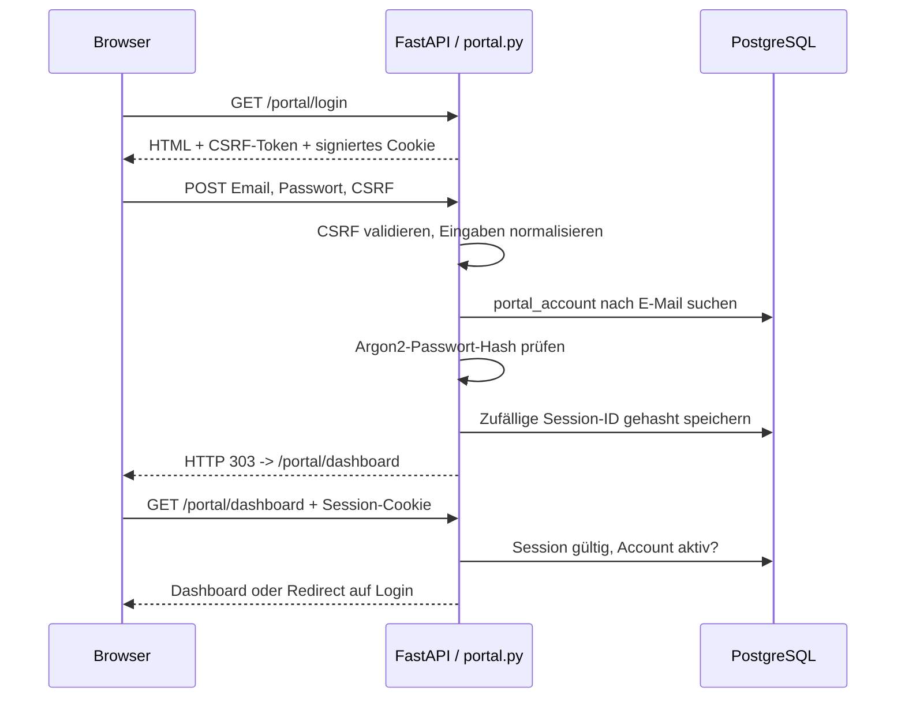

# Teamportal: Authentifizierung, Sessions und Zugriffsrechte

**Stand: 18. November 2026 · Administrator- und Partner-Testlogin im gemeinsamen Portal geprüft**

## 1. Login-Ablauf

Die Login-Oberfläche unter `/portal/login` verwendet `portal.py`, `templates/portal/login.html`, Jinja2 und PostgreSQL. Es gibt **keine öffentliche Selbstregistrierung**; der erste Administrator wurde kontrolliert in pgAdmin mit einem zuvor generierten Passwort-Hash angelegt.



## 2. Schutzmechanismen im implementierten Stand

| Mechanismus | Umsetzung / Aussagegrenze |
|---|---|
| Passwortspeicherung | `pwdlib` mit Argon2; kein Klartext in PostgreSQL |
| Sessions | Zufälliges `sid`, nur SHA-256-Hash in `portal_session` |
| Cookie | `SessionMiddleware`, signiert, `HttpOnly`, `Secure`, `SameSite=Strict`, `max_age=1800` |
| Serverseitige Prüfung | Für geschützte Seiten wird die Session gegen die DB und den aktiven Account geprüft |
| CSRF | Formular enthält verstecktes `csrf_token`; POST prüft mittels konstanter Zeitvergleichsfunktion |
| Falsches Passwort | Generische Fehlermeldung, keine Information über Existenz der E-Mail-Adresse |
| Account-Sperre | Nach fünf Fehlversuchen bei einem vorhandenen Account ungefähr 15 Minuten Sperrzeit |
| Nginx-Rate-Limit | Separat konfiguriert für `POST /portal/login` über HTTPS |
| Logout | `POST /portal/logout` prüft CSRF und löscht die DB-Session |
| Rollen | `admin` besitzt Gesamtrechte; `partner` nur Rechte an zugewiesenen Einrichtungen |

**Wichtige Einschränkung:** Das signierte Cookie ist nicht verschlüsselt; deshalb enthält es keine Passwörter oder sonstige sensiblen Profildaten. Der Session-Schlüssel steht in der serverseitigen `.env` und darf nicht in GitHub gelangen. Tests haben Basis-Login, Logout, CSRF und ohne Login geschützte Seiten bestätigt; eine unabhängige Sicherheitsprüfung/Penetrationstest wurde **nicht** durchgeführt.

## 3. Benötigte Python-Pakete

Im Projekt wurden zusätzlich zur bestehenden FastAPI-Installation die folgenden Pakete eingerichtet:

```bash
# Nur in der aktivierten virtuellen Python-Umgebung
python -m pip install 'pwdlib[argon2]' itsdangerous python-multipart python-dotenv httpx
```

- `pwdlib[argon2]` – Hashing und Passwortprüfung
- `itsdangerous` – für die Signatur von Starlette-Sessions
- `python-multipart` – Verarbeitung von HTML-Formulardaten
- `python-dotenv` – Einlesen der `.env`
- `httpx` – HTTP-Client des TestClients

Die aktuellen, tatsächlich installierten Versionen vor dem Release mit `python -m pip freeze` sichern. Die Entwicklungsinstallation ist noch kein reproduzierbarer, fest gepinnter Deployment-Lockfile-Stand.

## 4. Session-Schlüssel

In `~/yana-backend/.env` wurde `PORTAL_SESSION_SECRET` als kryptografisch zufälliger, langer Wert generiert. Er ist **keine öffentliche API-URL**. Der Schlüssel wird beim App-Start über `load_dotenv()`/`os.getenv()` geladen. Fehlt er oder ist er zu kurz, startet die Anwendung bewusst nicht.

```python
# Auszug aus main.py; hier ohne geheimen Wert
load_dotenv()
secret = os.getenv("PORTAL_SESSION_SECRET")
if not secret or len(secret) < 32:
    raise RuntimeError("PORTAL_SESSION_SECRET fehlt oder ist zu kurz.")

app.add_middleware(
    SessionMiddleware,
    secret_key=secret,
    session_cookie="yana_portal_session",
    max_age=1800,
    same_site="strict",
    https_only=True,
)
```

`https_only=True` bedeutet: Für Tests mit `TestClient` die `base_url="https://testserver"` verwenden. Browserzugriffe erfolgen über die tatsächlich eingerichtete HTTPS-Adresse. Der Server besitzt aktuell eine eigene IP-basierte TLS-Konfiguration.

## 5. Rollen und Servergrenzen

`portal.py` enthält `session_account(request)` und `check_csrf(request, token)`. Die Hilfestellen-Routen prüfen zusätzlich Rolle und Einrichtungszuordnung, u. a. mit `portal_access.py`. Für Partner reicht eine Anmeldung allein nicht aus: Einrichtungsrechte werden bei jeder relevanten Route serverseitig geprüft. Das Dashboard allein schützt keine Bearbeitungsroute; jede Datenänderung muss separat prüfen, ob das Konto berechtigt ist.

**Inzwischen umgesetzt:** Externe Accounts mit Rolle `partner` können sich anmelden und erhalten serverseitig nur Zugriff auf ihre in `portal_facility_assignment` verknüpften Einrichtungen. Veröffentlichung und Änderungsvorschläge werden durch Administratoren geprüft. **Offen:** Selbstregistrierung (derzeit nicht vorgesehen), Passwortzurücksetzung, MFA und eine Verwaltungsoberfläche für Accounts und Zuweisungen. Ein Testpartner wurde über pgAdmin erstellt.

## 6. Nginx-Schutz gegen Login-Fluten

Nach erfolgreichem Test des Logins wurde auf dem VPS eine `limit_req`-Regel in `/etc/nginx/conf.d/yana-portal-limit.conf` eingerichtet. Sie beschränkt **POST** auf `/portal/login` bei öffentlichem HTTPS-Port auf ca. fünf Anfragen pro Minute und Client-IP, zusätzlich mit `burst=5` und Status `429` bei Überschreitung. Die Syntaxprüfung `sudo nginx -t`, das Neuladen von Nginx und die anschließenden Smoke-Tests der Website/API waren erfolgreich.

Wichtig: Bestätigt wurden Konfigurationsannahme und fortgesetzte Erreichbarkeit, **nicht** ein automatisierter Belastungstest des Limits unter vielen Anfragen. Weil das Beispiel eine Regel auf `http`-Ebene einsetzt, ist die Vererbung/Wirksamkeit bei abweichenden `server`-/`location`-Konfigurationen vor echtem Produktivbetrieb erneut zu prüfen. Kontosperre und Rate-Limit ergänzen sich, ersetzen sich aber nicht.

## 7. Prüfung und Fehlerbilder

| Testfall | Erwartetes / bestätigtes Verhalten |
|---|---|
| GET `/portal/login` | `200` |
| Login mit gültigem Admin | `303` zu Dashboard |
| GET `/portal/dashboard` mit Session | `200` |
| GET `/portal/dashboard` ohne Session | `303` zum Login |
| POST `/portal/logout` mit CSRF | `303`, DB-Session wird entfernt |
| Dashboard nach Logout | `303` |
| Gefälschter CSRF-Token beim Login/Logout | `403` |
| Gleichzeitige Nutzung der Flutter-API | `/hilfestellen` weiterhin `200` |

Der Projektverlauf dokumentiert diese Tests als bestanden. Für einen neuen Deployment-Stand müssen sie erneut ausgeführt werden. Testdetails stehen unter [Portal-Teststrategie](teamportal-tests.md).

## 8. Sicherheitsaufgaben vor echtem Partnerbetrieb

- Keine Veröffentlichung echter vertraulicher Adressen / personenbezogener Daten über die öffentliche `/hilfestellen`-API.
- Bestehende Partnerzuordnung und Berechtigungsprüfung mit weiteren Accounts, abgelaufenen Sessions und parallelen Anträgen regressionsprüfen; Benutzerverwaltung mit Entzug von Zuweisungen ergänzen.
- Sitzungs-/Cookie-/CSRF-Integration in realistischen Browsern prüfen, Passwort-Reset und MFA-Konzept definieren.
- Nginx-Rate-Limit unter kontrollierten Bedingungen prüfen; Proxy-IP-Vertrauen korrekt konfigurieren.
- Secret-Rotation, Audit- und Löschkonzept; zuverlässige DB-Backups und Recovery-Test.

Siehe [Betrieb und Sicherheit](betrieb-sicherheit.md).
