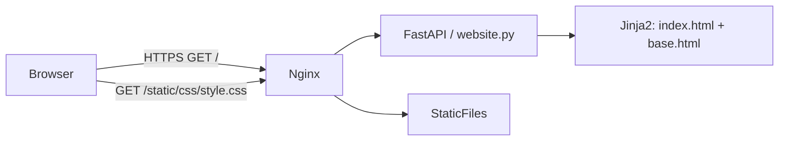

# Öffentliche Website: Landingpage und App-Informationen

**Dokumentationsstand: 24. November 2026 · Weiß-lila Redesign produktiv und im Browser bestätigt**

## Zweck und Abgrenzung

Die Website informiert über **YANA – You Are Not Alone**, erläutert den vorgesehenen Nutzen der mobilen App und bereitet einen späteren Downloadbereich vor. Sie ist **keine** eigenständige Beratungs- oder Notfallanwendung. Das Webportal für Mitarbeitende ist ein separater, angemeldeter Bereich unter `/portal/`.

Der öffentliche Bereich ist bereits über den HTTPS-Zugang des IONOS-VPS erreichbar. Ein tatsächlicher App-Store-Download ist **noch nicht** verfügbar; die Website kennzeichnet den Download als ausstehend. Die Inhalte beziehen sich auf ein Schul-/Entwicklungsprojekt mit fiktiven Hilfestellendaten. Eigene finale App-Screenshots und rechtlich geprüfte Texte stehen noch aus; das weiß-lila YANA-Branding ist inzwischen produktiv umgesetzt.

## Implementierung

| Bestandteil | Datei im GitHub-Repository | Aufgabe |
|---|---|---|
| FastAPI-Router | `services/api/website.py` | `GET /` rendert die Landingpage mit Jinja2 |
| HTML-Basis | `services/api/templates/base.html` | `<head>`, CSS-Einbindung und gemeinsamer Inhaltsblock |
| Startseite | `services/api/templates/index.html` | Begrüßung, Funktionen, Download-Hinweis |
| Styling | `services/api/static/css/style.css` | Responsives Layout, Navigation, Hero, Karten und Footer |
| Einbindung | `services/api/main.py` | Router registrieren, `/static` über `StaticFiles` anbieten |

**Technik:** HTML, CSS, Jinja2-Templates und FastAPI. Ein separates JavaScript-Frontend-Framework ist für diesen Stand nicht notwendig. Der frühere JSON-Willkommensendpunkt unter `/` wurde durch die HTML-Startseite ersetzt. Die JSON-Endpunkte `/health`, `/hilfestellen`, `/kategorien` und `/notfallnummern` bleiben bestehen.



## Funktionalität: Ist und geplant

| Funktion | Stand 24.11.2026 |
|---|---|
| Informationsseite, Navigation, responsive Grundgestaltung | **Umgesetzt; neues weiß-lila YANA-Design produktiv bestätigt** |
| Öffentliche HTTPS-Auslieferung über Nginx/FastAPI | **Umgesetzt** |
| Informationskarten zu Hilfsangeboten/Notfallkontakten | **Umgesetzt als erklärender Text** |
| App-Store-/APK-Downloadlink | **Noch nicht veröffentlicht** |
| Rechtlich geprüfte Notfallberatung über die Website | **Nicht implementiert** |
| Teamportal-Link und Login | **Rechts oben auf Landingpage**, gemeinsamer Login mit Hinweis für registrierte Kanzleien, Hilfestellen und Mitarbeitende; siehe [Teamportal](teamportal-architektur.md) |
| Portalnavigation und Logout | Gemeinsames Layout; Abmeldung in oberer Navigation der Portalseiten |
| Partner- und Standortübersichten | Kompakte Tabellen mit Suche, Filter und ausklappbaren Details |

## Prüfung nach Deployments

```bash
# Öffentliche Startseite
curl -sS -o /dev/null -w '%{http_code}\n' https://SERVER_IP/

# Statische CSS-Datei
curl -sS -o /dev/null -w '%{http_code}\n' https://SERVER_IP/static/css/style.css

# Unveränderte Flutter-API
curl -sS -o /dev/null -w '%{http_code}\n' https://SERVER_IP/hilfestellen
```

Erwartet wird jeweils HTTP 200. `SERVER_IP` steht für die reale VPS-Adresse; Zertifikatsprüfung nicht mit `-k` umgehen. Für Tests mit falscher URL können Browser-Caches die Anzeige beeinflussen.

## Verantwortlichkeiten

Website-Quellcode liegt im gemeinsamen GitHub-Repository, die **ausführbaren Dateien** auf dem IONOS-Server unter `~/yana-backend`. Die PostgreSQL-Daten liegen ausschließlich in der Datenbank. Details zum Ablauf stehen unter [GitHub und Deployment](git-deployment.md) und [Server-Bereitstellung](teamportal-deployment.md).

## Gestaltungsstandard für neue Seiten (24.11.2026)

Das Projekt verwendet das [YANA-Designsystem](designsystem.md): weißer Hintergrund, markante lila Akzente, dezente Lavendel-Flächen und eine einheitliche Navigation. Neue Verwaltungsseiten sollen das vorhandene `base.html` und die zentralen CSS-Regeln verwenden. Backend-Rollen und CSRF sind auch nach gestalterischen Änderungen unverändert serverseitig zu prüfen.
